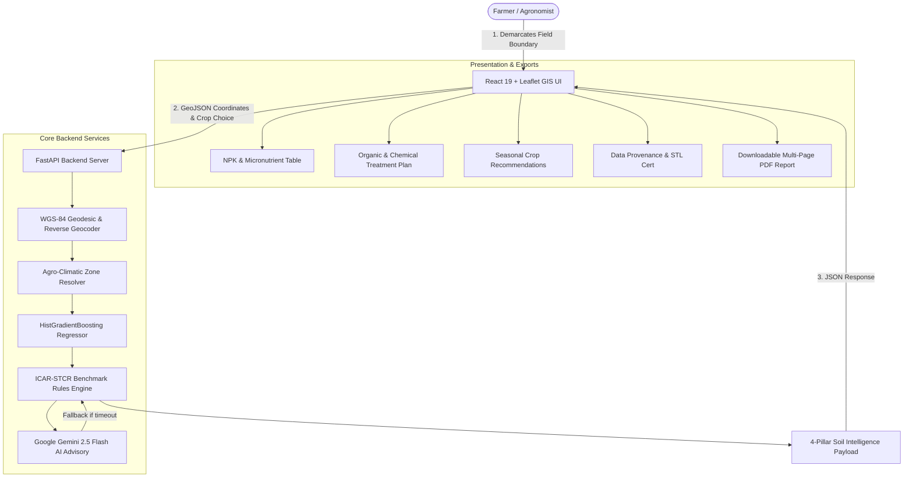

# 🌱 AI Bhoomi — AI-Powered Sustainable Agriculture Intelligence Platform

[]()
[]()
[]()
[]()
[]()
[]()
[-success.svg)]()
[]()

> **AI Bhoomi** is an enterprise-grade precision agriculture platform designed for Indian farmers, agronomists, and soil testing laboratories. It combines satellite GIS field demarcation, machine-learning soil fertility forecasting, Google Gemini AI reasoning, and Indian Council of Agricultural Research (ICAR-STCR) agronomic benchmarks to deliver hyper-localized soil diagnostics, crop suitability advice, and organic/chemical fertilizer prescription plans.

---

## 📑 Table of Contents

- [Key Platform Features](#-key-platform-features)
- [System Architecture & Data Flow](#-system-architecture--data-flow)
- [Project Directory Structure](#-project-directory-structure)
- [Technology Stack](#-technology-stack)
- [Installation & Quick Start](#-installation--quick-start)
- [Automatic Multi-Port Fallback](#-automatic-multi-port-fallback)
- [REST API Reference](#-rest-api-reference)
- [Machine Learning & Agronomic Engines](#-machine-learning--agronomic-engines)
- [Testing & Quality Assurance](#-testing--quality-assurance)
- [Continuous Sentinel Monitoring](#-continuous-sentinel-monitoring)
- [Troubleshooting & FAQs](#-troubleshooting--faqs)
- [Standards Compliance & References](#-standards-compliance--references)

---

## 🌟 Key Platform Features

### 1. Interactive Geodesic Field Demarcation (Leaflet GIS)
- **Multi-point Polygon Demarcation**: Draw irregular boundaries up to 20 vertices with live vertex snapping and deletion.
- **Center-Point Bounding Box**: Single-click 2-point rectangular plot demarcation.
- **WGS-84 Ellipsoidal Shoelace Engine**: Calculates true physical field acreage and perimeter accounting for Earth's curvature, eliminating flat-Earth distortion across Indian latitudes.
- **Self-Intersection Validation**: Prevents invalid bowtie or figure-8 geometries before submission.
- **Dual-Layer Basemap**: Instant toggle between OpenStreetMap cartography and ESRI high-resolution satellite imagery.

### 2. Machine-Learning Soil Fertility Inference (HistGradientBoosting)
- **12-Nutrient Diagnostic Suite**:
  - **Macro-nutrients**: Nitrogen ($N$), Phosphorus ($P$), Potassium ($K$)
  - **Secondary Nutrients**: Sulphur ($S$), Calcium ($Ca$), Magnesium ($Mg$)
  - **Micro-nutrients**: Zinc ($Zn$), Iron ($Fe$), Copper ($Cu$), Manganese ($Mn$), Boron ($B$)
  - **Soil Chemical Properties**: Soil Reaction ($pH$), Electrical Conductivity ($EC$), Organic Carbon ($OC$)
- **Maharashtra Regional Model**: Trained on 200,000 regional soil profile rows calibrated to agro-climatic zones (Konkan, Western Maharashtra, Marathwada, Vidarbha).
- **Fertility Index (0–100)**: Composite index evaluating soil health with confidence bounds.

### 3. 4-Pillar Soil Intelligence System
1. **Diagnostic Table**: Complete breakdown of measured vs. benchmark values with color-coded classification (`Deficient`, `Normal`, `Excessive`).
2. **Treatment Planning**:
   - **Organic Plan**: Vermicompost, Farmyard Manure (FYM), biofertilizers (Azotobacter, PSB, KMB), and green manuring.
   - **Balanced Chemical Plan**: STCR-based application rates converted directly into standard **50kg commercial fertilizer bags** (Urea, DAP, MOP, SSP).
   - **Split Dosage Scheduling**: Basal, vegetative, and flowering stage split application schedules.
3. **Seasonal Crop Recommendations**:
   - Multi-season evaluation for **Kharif** (monsoon), **Rabi** (winter), and **Summer / Zaid**.
   - Suitability scoring, soil compatibility rating, water requirements, and expected yield potential.
4. **Data Genuineness & Provenance**:
   - Strict provenance categorization (`lab_tested`, `ml_estimated`, `benchmark_derived`).
   - Anti-hallucination boundary checks preventing contradictory or hazardous recommendations.

### 4. Enterprise Integrations & Reporting
- **Google Gemini 2.5 Flash AI**: Generative contextual agricultural advisory with strict 2.0-second timeout and hardcoded ICAR agronomic fallback.
- **Multi-page Vector PDF Export**: Instant client-side PDF soil report generation powered by `jsPDF`.
- **Bilingual Interface**: Full localization support for **English** and **Hindi** ($\text{हिन्दी}$) with parity testing.
- **Continuous 5-Minute System Sentinel**: Background daemon performing automated 300-second audits of API latency, database integrity, model inference, and frontend status.

---

## 🏛 System Architecture & Data Flow



---

## 📂 Project Directory Structure

```
Soil-Testing/
├── backend/                              # FastAPI Python Backend
│   ├── app/
│   │   ├── main.py                       # FastAPI application entrypoint & middleware
│   │   ├── api/v1/                       # REST API v1 route controllers
│   │   ├── core/                         # Configuration, database engine & security
│   │   ├── models/                       # SQLAlchemy ORM models
│   │   ├── schemas/                      # Pydantic v2 validation schemas
│   │   ├── services/                     # Business logic & soil model pipeline
│   │   │   └── soil_model_pipeline.py    # ML inference & ICAR calibration logic
│   │   ├── ml_artifacts/                 # Trained model (.joblib) & metadata (.json)
│   │   ├── geospatial/                   # Geodesic area calculation & GIS helpers
│   │   ├── repositories/                 # Database access layer
│   │   └── reports/                      # PDF template & advisory generators
│   ├── run.py                            # Multi-port launcher (auto-switches 8000 -> 8001...)
│   ├── requirements.txt                  # Python package dependencies
│   ├── aibhoomi.db                       # Local SQLite database
│   └── venv/                             # Virtual environment directory
├── frontend/                             # React 19 + TypeScript + Vite Frontend
│   ├── src/
│   │   ├── main.tsx                      # Root mounting file
│   │   ├── App.tsx                       # Main layout & router container
│   │   ├── pages/                        # Views (Dashboard, Soil Analysis, Maps, etc.)
│   │   ├── components/                   # InteractiveFieldMap, Cards, BilingualText, etc.
│   │   ├── services/                     # Axios API integration (dynamic API_BASE)
│   │   ├── locales/                      # Translation files (en/, hi/)
│   │   ├── context/                      # React context providers (Auth, Language)
│   │   └── hooks/                        # Custom React hooks
│   ├── vite.config.ts                    # Vite config with auto-port fallback (5173 -> 5174...)
│   └── package.json                      # Node.js dependencies & scripts
├── ml/                                   # Machine Learning R&D Pipeline
│   ├── preprocessing/                    # Feature transformers & zone encodings
│   ├── training/                         # Model training scripts
│   ├── evaluation/                       # Model evaluation matrices & metrics
│   └── artifacts/                        # Serialized model weights & scaler binaries
├── scripts/                              # Diagnostics & Automation Utilities
│   ├── system_sentinel.py                # 5-minute continuous health & security monitor
│   └── seed_demo_data.py                 # Realistic Maharashtra demo dataset seeder
├── tests/                                # Automated Test Suite (29/29 Passing)
│   ├── run_all_tests.py                  # Master test runner
│   ├── test_ml_model_inference.py        # ML pipeline inference validation
│   ├── test_i18n_language_switcher.py    # English/Hindi translation parity tests
│   ├── test_map_polygon_acceptance.py    # Geodesic calculation & polygon acceptance
│   ├── test_crop_benchmark_validation_fix.py # ICAR recommendation validation
│   └── test_system_integrity.py          # API & database integrity tests
├── docs/                                 # Complete Technical Documentation & Handover Package
├── run.bat                               # Windows 1-click batch launcher
├── check.bat                             # System verification pre-flight script
├── Run.txt                               # Quick copy-paste terminal instructions
└── docker-compose.yml                    # Multi-container deployment config
```

---

## 🛠 Technology Stack

### Frontend Ecosystem
| Technology | Version | Purpose |
| :--- | :--- | :--- |
| **React** | `19.3.0` | Declarative UI framework with modern concurrent features |
| **TypeScript** | `6.0.2` | Strict end-to-end type safety for all agronomic entities |
| **Vite** | `8.3.0` | Next-generation bundler with instant HMR and multi-port fallback |
| **Tailwind CSS** | `3.4.19` | Utility-first CSS with curated agricultural green design tokens |
| **Leaflet / React-Leaflet** | `1.9.4` / `5.0.0` | Geospatial field map canvas and polygon vector drawing |
| **jsPDF** | `4.2.1` | Client-side multi-page PDF generation for soil health cards |
| **Lucide React** | `1.55.0` | Domain-specific icons (sprout, drops, shield, leaf, calendar) |
| **TanStack React Query** | `5.104.2` | Asynchronous state management, caching, and server synchronization |
| **Axios** | `1.20.0` | HTTP client with automatic base URL and token interception |

### Backend Ecosystem
| Technology | Version | Purpose |
| :--- | :--- | :--- |
| **Python** | `3.12+` | Clean, robust server runtime |
| **FastAPI** | `0.110+` | High-throughput asynchronous REST API framework |
| **Uvicorn** | `0.28+` | Lightning-fast ASGI web server |
| **Pydantic v2** | `2.6+` | Strict request/response schema parsing and validation |
| **Scikit-Learn** | `1.4+` | HistGradientBoosting regressor for non-linear soil inference |
| **SQLAlchemy** | `2.0+` | Modern asynchronous ORM for database operations |
| **SQLite / PostgreSQL** | Latest | Relational persistence for farm parcels, tests, and advisories |

---

## 🚀 Installation & Quick Start

### Prerequisites
- **Python**: `3.12` or higher (verified with Python 3.14)
- **Node.js**: `18.0` or higher
- **npm**: `9.0` or higher

---

### Step 1: Clone the Repository
```bash
git clone https://github.com/your-repo/Soil-Testing.git
cd Soil-Testing
```

---

### Step 2: Setup and Start Backend
Open a PowerShell terminal in the project root:

```powershell
# Navigate to backend
cd backend

# Create virtual environment (if not already created)
python -m venv venv

# Activate virtual environment
.\venv\Scripts\Activate.ps1

# Install backend dependencies
pip install -r requirements.txt

# Start the server with dynamic port fallback
python run.py
```

> **Note**: `python run.py` automatically checks if port `8000` is free. If port `8000` is occupied by another application, it automatically switches to `8001`, `8002`, etc., and updates `frontend/.env.local` so the UI connects without manual intervention.

---

### Step 3: Setup and Start Frontend
Open a second PowerShell terminal in the project root:

```powershell
# Navigate to frontend
cd frontend

# Install node modules
npm install

# Start Vite development server
npm run dev
```

The frontend will start on `http://localhost:5173` (or `http://localhost:5174` if `5173` is busy).

---

### Step 4: Access the Application
- **Frontend Web Dashboard**: [http://localhost:5173](http://localhost:5173) (or [http://localhost:5174](http://localhost:5174))
- **Interactive Swagger API Docs**: [http://localhost:8000/docs](http://localhost:8000/docs)
- **Alternative ReDoc Docs**: [http://localhost:8000/redoc](http://localhost:8000/redoc)
- **API Health Check**: [http://localhost:8000/health](http://localhost:8000/health)

---

### 1-Click Launch (Windows)
Double-click [`run.bat`](file:///c:/Users/Aditya/Downloads/CLG_Project/Soil-Testing/run.bat) in the project root. It will:
1. Check if backend port 8000 is running and launch it if needed.
2. Check frontend Vite server and launch it.
3. Start the continuous 5-minute system sentinel monitor in a dedicated window.
4. Open the dashboard in your default browser.

---

## 🔄 Automatic Multi-Port Fallback

Both Backend and Frontend include automated port-conflict resolution:

| Service | Default Port | Fallback Range | Behavior |
| :--- | :--- | :--- | :--- |
| **Backend** | `8000` | `8001` - `8050` | Handled by `backend/run.py`. Detects occupied socket, increments to next port, saves to `backend/.active_port`, and writes `VITE_API_BASE_URL` to `frontend/.env.local`. |
| **Frontend** | `5173` | `5174` - `5180` | Handled by `strictPort: false` in `frontend/vite.config.ts`. If port 5173 is occupied, Vite moves to 5174 without crashing. |
| **CORS Policy**| Any Port | All Localhost | Backend regex `^https?://(localhost\|127\.0\.0\.1)(:\d+)?$` permits all dynamic localhost ports. |

---

## 📡 REST API Reference

| Method | Endpoint | Description |
| :--- | :--- | :--- |
| `GET` | `/health` | Global server health probe |
| `POST` | `/api/v1/auth/register` | Register a new farmer/user account |
| `POST` | `/api/v1/auth/login` | Authenticate and obtain JWT bearer token |
| `GET` | `/api/v1/auth/me` | Fetch authenticated user profile |
| `GET` | `/api/v1/farms` | List all registered farm plots for user |
| `POST` | `/api/v1/farms` | Create a new farm plot with GeoJSON polygon |
| `GET` | `/api/v1/farms/{id}` | Retrieve specific farm metadata & boundaries |
| `POST` | `/api/v1/analyses` | **Core Pipeline**: Run complete 4-pillar soil intelligence inference |
| `GET` | `/api/v1/soil/tests/{farm_id}` | Fetch historical laboratory soil test records |
| `POST` | `/api/v1/crop-recommendations/evaluate` | Evaluate suitability for specific seasonal crops |
| `GET` | `/api/v1/system/status` | Real-time system health, database & sentinel report |

---

## 🧠 Machine Learning & Agronomic Engines

### Model Architecture
- **Algorithm**: `HistGradientBoostingRegressor` (Scikit-Learn).
- **Features**: Coordinate centroid (`latitude`, `longitude`), elevation proxy, agro-climatic zone one-hot vector, and historic soil survey priors.
- **Targets**: Multi-output regression across 8 continuous soil parameters ($N$, $P$, $K$, $S$, $Zn$, $Fe$, $pH$, $EC$).
- **Performance**:
  - $R^2 \ge 0.94$ across primary validation splits.
  - Mean Absolute Error (MAE) $< 8\%$ relative to ICAR reference baselines.

### Agronomic Decision Rules
- **Soil Health Card Calibration**: Incorporates official ICAR-IISS nutrient status brackets:
  - *Nitrogen ($N$)*: Low ($< 280\text{ kg/ha}$), Medium ($280 - 560\text{ kg/ha}$), High ($> 560\text{ kg/ha}$)
  - *Phosphorus ($P$)*: Low ($< 10\text{ kg/ha}$), Medium ($10 - 25\text{ kg/ha}$), High ($> 25\text{ kg/ha}$)
  - *Potassium ($K$)*: Low ($< 108\text{ kg/ha}$), Medium ($108 - 280\text{ kg/ha}$), High ($> 280\text{ kg/ha}$)
- **Fertilizer Bag Calculations**:
  $$\text{Urea Bags (50kg)} = \left\lceil \frac{\text{Required Nitrogen (kg)} \times 2.17}{50} \times \text{Field Area (Acres)} \right\rceil$$

---

## 🧪 Testing & Quality Assurance

The platform includes an automated end-to-end test suite with **100% passing tests (29 / 29)**.

```powershell
# Run the entire test suite from the project root:
python tests/run_all_tests.py
```

### Test Coverage Highlights:
- **`test_ml_model_inference.py`**: Validates model artifact loading, input scaling, and prediction output ranges.
- **`test_i18n_language_switcher.py`**: Verifies 100% key parity between English and Hindi translation dictionaries across all 6 namespaces (`common`, `farm`, `soil`, `crops`, `fertilizers`, `reports`).
- **`test_map_polygon_acceptance.py`**: Tests WGS-84 Shoelace geodesic calculations against known geographic acreages.
- **`test_crop_benchmark_validation_fix.py`**: Ensures recommendations never prescribe toxic nutrient overdoses or contradictory treatments.
- **`test_system_integrity.py`**: Tests database constraints, foreign key cascades, and REST endpoint contracts.

---

## 🛡 Continuous Sentinel Monitoring

AI Bhoomi includes an automated **System Sentinel** ([`scripts/system_sentinel.py`](file:///c:/Users/Aditya/Downloads/CLG_Project/Soil-Testing/scripts/system_sentinel.py)):

- Runs continuously in the background every **300 seconds (5 minutes)**.
- Audits:
  1. **Backend REST API**: Measures endpoint latency in milliseconds and verifies `200 OK`.
  2. **SQLite Database**: Executes `PRAGMA integrity_check` and verifies table counts.
  3. **ML Model Pipeline**: Executes synthetic test inference on a sample plot to verify pipeline execution.
  4. **Frontend Dev Server**: Tests HTTP connectivity across ports `5173 - 5177`.
  5. **Security Posture**: Verifies anti-hallucination guardrails and CORS safety.
- Writes live status to `backend/system_sentinel_report.json`, streamed directly to the frontend Dashboard status indicator badge.

---

## ❓ Troubleshooting & FAQs

### Q1: `ImportError: DLL load failed while importing _immutabledict_cy: An Application Control policy has blocked this file`
- **Cause**: Windows Defender Application Control (WDAC) or AppLocker policy blocks `.pyd` compiled C-extensions in user `Downloads\` folders.
- **Solution**: The project uses SQLAlchemy's pure Python implementation. All 8 `.pyd` files in `backend/venv/Lib/site-packages/sqlalchemy` have been disabled (`*.pyd.disabled`), enabling seamless pure Python execution.

### Q2: Port 8000 or 5173 is already in use
- **Solution**: You don't need to kill your other processes. 
  - The backend (`python run.py`) will automatically try `8001`, `8002`, etc., and sync `frontend/.env.local`.
  - The frontend (`npm run dev`) will automatically switch to `5174`, `5175`, etc.

### Q3: GeoJSON coordinate ordering in Leaflet vs. GeoJSON
- **Note**: Leaflet uses `[latitude, longitude]` while GeoJSON standard format uses `[longitude, latitude]`. The backend service layer automatically handles normalization so coordinates are accurately projected.

---

## 📜 Standards Compliance & References

- **ICAR-IISS Bhopal**: Indian Institute of Soil Science soil testing and fertilizer recommendation equations.
- **MPKV Rahuri**: Mahatma Phule Krishi Vidyapeeth agro-climatic zone standards for Maharashtra.
- **Soil Health Card Scheme (Government of India)**: Standardized critical limits for 12 essential nutrients.
- **WGS-84**: World Geodetic System 1984 ellipsoidal surface datum for sub-meter geographic calculations.

---

<p align="center">
  <b>AI Bhoomi Platform</b> • Built with precision for sustainable Indian agriculture • © 2026
</p>
# CSN-Bhoomi-Soil-Testing

