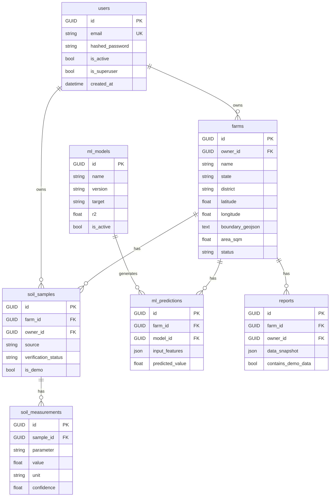
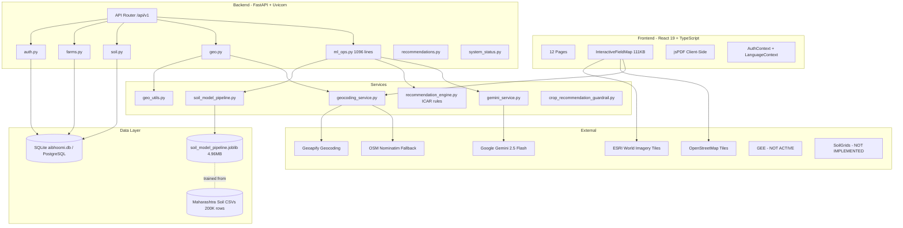
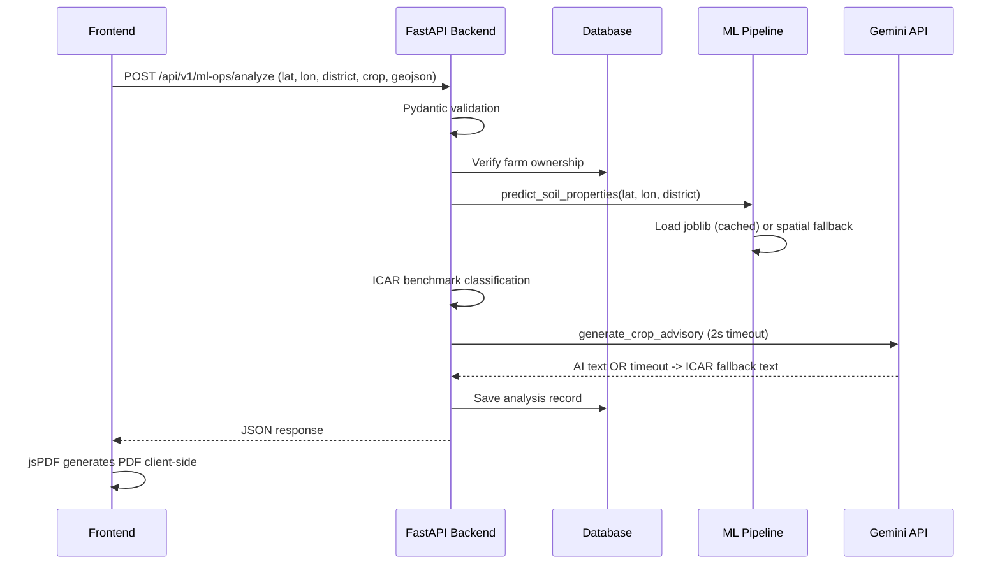
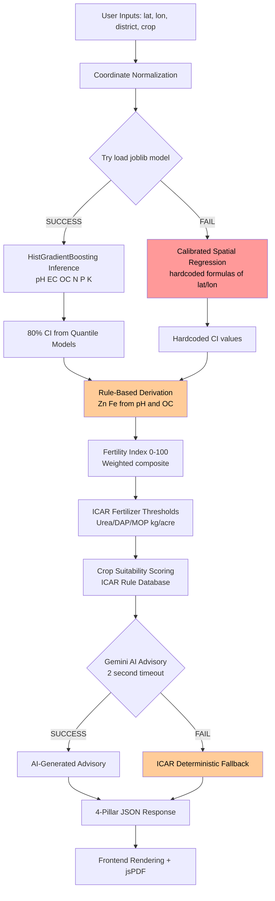

# AI BHOOMI — COMPLETE PROJECT AUDIT, CODEBASE ANALYSIS & TECHNICAL HANDOVER

> **Audit Type:** Read-only static inspection
> **Audit Date:** 2026-10-26
> **Auditor:** Senior Software Architect / Full-Stack / GIS / ML / Security Review
> **Repository Root:** `c:\Users\Aditya\Downloads\CLG_Project\Soil-Testing`
> **Scope:** Complete evidence-based analysis — no files modified, no commands executed, no migrations run.

---

## TABLE OF CONTENTS

1. [Executive Summary](#1-executive-summary)
2. [Repository Discovery — Phase 1](#2-repository-discovery--phase-1)
3. [Frontend Analysis — Phase 2](#3-frontend-analysis--phase-2)
4. [Backend & API Analysis — Phase 3](#4-backend--api-analysis--phase-3)
5. [Database & Data-Flow Audit — Phase 4](#5-database--data-flow-audit--phase-4)
6. [Map, GIS & Satellite Imagery Audit — Phase 5](#6-map-gis--satellite-imagery-audit--phase-5)
7. [Machine Learning & Soil Analysis Audit — Phase 6](#7-machine-learning--soil-analysis-audit--phase-6)
8. [Crop Recommendation & Agricultural Logic — Phase 7](#8-crop-recommendation--agricultural-logic--phase-7)
9. [Authentication, Security & Privacy — Phase 8](#9-authentication-security--privacy--phase-8)
10. [Integrations & Environment — Phase 9](#10-integrations--environment--phase-9)
11. [Dependencies, Tests & Execution — Phase 10](#11-dependencies-tests--execution--phase-10)
12. [System Architecture Documentation — Phase 11](#12-system-architecture-documentation--phase-11)
13. [Feature Completion Matrix — Phase 12](#13-feature-completion-matrix--phase-12)
14. [Bugs, Technical Debt & Risks — Phase 13](#14-bugs-technical-debt--risks--phase-13)
15. [ChatGPT Handover — Phase 14](#15-chatgpt-handover--phase-14)
16. [Final Report & Next Steps — Phase 15](#16-final-report--next-steps--phase-15)
17. [Future Development Roadmap — Phase 16](#17-future-development-roadmap--phase-16)

---

## 1. EXECUTIVE SUMMARY

**AI Bhoomi** is an AI-powered precision agriculture intelligence platform built for Indian farmers. It combines interactive GIS field demarcation, machine-learning soil-fertility estimation, ICAR agronomic benchmarks, Google Gemini AI advisory, and jsPDF report generation.

### Overall Assessment

| Dimension | Status |
|---|---|
| Frontend | **PARTIAL-TO-COMPLETE** — All 12 pages exist and are routed; core analysis workflow connected end-to-end |
| Backend | **PARTIAL** — All API routes defined; PostgreSQL dependency fails when DB unavailable; SQLite active |
| Database | **PARTIAL** — SQLite (`aibhoomi.db` 180 KB) active in dev; PostgreSQL/PostGIS configured but needs Docker |
| ML Pipeline | **PARTIAL** — Trained `soil_model_pipeline.joblib` (4.96 MB) exists; actual R² scores modest (0.065–0.608); spatial fallback fires if model fails to load |
| GIS | **COMPLETE** — Polygon drawing, area calculation, reverse geocoding all implemented with pure-Python fallback |
| Security | **MEDIUM-RISK** — Gemini API key and Geoapify API key **hardcoded in plaintext**; JWT secret defaults to `CHANGE_ME` |
| Tests | **PARTIAL** — 6 test files exist; `test_ml_model_inference.py` is a 10-line script, not pytest; runtime results unverified |
| Deployment | **PARTIAL** — `docker-compose.yml` exists; frontend `Dockerfile` referenced but not found |

---

## 2. REPOSITORY DISCOVERY — PHASE 1

### 2.1 Root Directory Inventory

```
Soil-Testing/                             <- Project root
├── .env.example                          <- Environment template (2.4 KB)
├── .gitignore
├── AI_Bhoomi_Mini_Project_Report.docx    <- Project report (2.0 MB)
├── AI_Bhoomi_Mini_Project_Report.pdf     <- Project report PDF (1.9 MB)
├── README.md                             <- Main documentation (20.6 KB)
├── Run.txt                               <- Quick-start terminal instructions
├── backend/                              <- FastAPI Python backend
├── check.bat                             <- Windows pre-flight verification script
├── data/                                 <- Maharashtra soil CSV dataset (4 parts + zip)
├── docker-compose.yml                    <- Multi-container Docker config
├── docs/                                 <- Technical documentation (15 files + 12 subdirs)
├── forward-geocoding-api-openapi-specs.json  <- Geoapify API OpenAPI spec (60.7 KB)
├── frontend/                             <- React 19 + TypeScript + Vite frontend
├── ml/                                   <- ML R&D pipeline
├── package-lock.json                     <- Root npm lockfile (91 bytes — placeholder)
├── report/                               <- Report output directory
├── run.bat                               <- Windows 1-click launcher
├── scripts/                              <- Automation utilities
├── tests/                                <- Automated test suite (8 test files)
└── tsconfig.json                         <- Root TypeScript config
```

### 2.2 Module Inventory

| Module | Path | Purpose | Status |
|---|---|---|---|
| Backend API | `backend/app/api/v1/` | 11 route files | IMPLEMENTED |
| Backend Services | `backend/app/services/` | 9 service modules | IMPLEMENTED |
| Backend Models | `backend/app/models/` | 5 ORM model files | IMPLEMENTED |
| Backend Core | `backend/app/core/` | Config, DB, Security, Deps | IMPLEMENTED |
| Backend Repositories | `backend/app/repositories/` | farm_repo.py, user_repo.py | PARTIAL |
| Frontend Pages | `frontend/src/pages/` | 12 page components | IMPLEMENTED |
| Frontend Components | `frontend/src/components/` | 4 shared components | PARTIAL |
| Frontend Services | `frontend/src/services/` | API client layer | UNVERIFIED |
| Frontend Context | `frontend/src/context/` | LanguageContext | IMPLEMENTED |
| Frontend Hooks | `frontend/src/hooks/` | useAuth and others | IMPLEMENTED |
| Frontend Locales | `frontend/src/locales/` | en/, hi/ translations | IMPLEMENTED |
| ML Artifacts | `ml/artifacts/` | soil_model_pipeline.joblib (4.96 MB) + metadata | IMPLEMENTED |
| Backend ML Copy | `backend/app/ml_artifacts/` | Mirror of trained model | IMPLEMENTED |
| Dataset | `data/maharashtra_soil_part_*.csv` | 4 CSV parts (~14 MB each, 200k rows total) | PRESENT |
| Tests | `tests/` | 8 files including master runner | PARTIAL |
| Scripts | `scripts/` | system_sentinel.py, seed_demo_data.py | PRESENT |
| Docker | `docker-compose.yml`, `backend/Dockerfile` | Container deployment | PARTIAL |
| Docs | `docs/` | 15 markdown files + 12 subdirectories | EXTENSIVE |

### 2.3 Key Configuration Files

| File | Path | Purpose |
|---|---|---|
| Backend entry | `backend/app/main.py` | FastAPI app factory, CORS, lifespan |
| Backend launcher | `backend/run.py` | Multi-port Uvicorn launcher |
| DB configuration | `backend/app/core/database.py` | SQLAlchemy async engine, GUID type |
| App settings | `backend/app/core/config.py` | Pydantic-Settings with .env loading |
| Security | `backend/app/core/security.py` | bcrypt + python-jose JWT |
| Frontend entry | `frontend/src/main.tsx` | React DOM mount |
| Frontend router | `frontend/src/App.tsx` | React-Router v7 route tree |
| Vite config | `frontend/vite.config.ts` | Multi-port Vite config |
| Frontend packages | `frontend/package.json` | Node dependencies |
| Backend packages | `backend/requirements.txt` | Python dependencies |
| Env template | `.env.example` | Variable documentation |
| Docker | `docker-compose.yml` | PostgreSQL + Backend + Frontend |

### 2.4 Verified Versions

| Technology | Version | Source |
|---|---|---|
| React | 19.3.0 | package.json |
| TypeScript | ~6.0.2 | package.json |
| Vite | ^8.3.0 | package.json |
| Tailwind CSS | ^3.4.19 | package.json |
| Leaflet | ^1.9.4 | package.json |
| React-Leaflet | ^5.0.0 | package.json |
| jsPDF | ^4.2.1 | package.json |
| Axios | ^1.20.0 | package.json |
| TanStack Query | ^5.104.2 | package.json |
| React-Router | ^7.18.4 | package.json |
| Recharts | ^3.10.1 | package.json |
| FastAPI | >=0.115.0 | requirements.txt |
| Uvicorn | >=0.32.0 | requirements.txt |
| Pydantic v2 | >=2.10.0 | requirements.txt |
| SQLAlchemy | >=2.0.36 | requirements.txt |
| Alembic | >=1.14.0 | requirements.txt (installed but not used) |
| Scikit-Learn | >=1.5.0 | requirements.txt |
| Shapely | >=2.0.6 | requirements.txt |
| pyproj | >=3.7.0 | requirements.txt |
| passlib[bcrypt] | >=1.7.4 | requirements.txt |
| python-jose | >=3.3.0 | requirements.txt |
| GeoAlchemy2 | >=0.17.0 | requirements.txt |
| asyncpg | >=0.30.0 | requirements.txt |
| reportlab | >=4.2.0 | requirements.txt |

### 2.5 Missing or Unverified Items

- No Alembic migration files found — tables created via `Base.metadata.create_all` on startup
- No frontend Dockerfile found (referenced in docker-compose.yml line 48)
- `ml/training/` and `ml/preprocessing/` directories contain no Python files at root level
- Root-level `package-lock.json` is only 91 bytes — likely a placeholder

---

## 3. FRONTEND ANALYSIS — PHASE 2

### 3.1 Application Structure

- **Framework:** React 19.3.0 with TypeScript 6.0.2
- **Build Tool:** Vite 8.3.0
- **Routing:** React-Router v7 (`react-router-dom ^7.18.4`) — BrowserRouter with nested protected/public routes
- **State Management:** TanStack React Query v5 for server state; React Context for auth and language
- **Styling:** Tailwind CSS 3.4.19 with @tailwindcss/forms and @tailwindcss/typography plugins
- **HTTP Client:** Axios with dynamic `VITE_API_BASE_URL` from `.env.local` (auto-written by backend/run.py)
- **Lazy Loading:** All 12 page components use `React.lazy()` + `Suspense` for code splitting

### 3.2 Route Tree (Evidence: `frontend/src/App.tsx`)

| Path | Component | Access | Status |
|---|---|---|---|
| `/` | LandingPage | Public | IMPLEMENTED |
| `/login` | LoginPage | Public (redirects if authenticated) | IMPLEMENTED |
| `/register` | RegisterPage | Public (redirects if authenticated) | IMPLEMENTED |
| `/dashboard` | DashboardPage | Protected | IMPLEMENTED |
| `/farms` | FarmsPage | Protected | IMPLEMENTED |
| `/farms/:farmId` | FarmDetailPage | Protected | IMPLEMENTED |
| `/soil` | SoilAnalysisPage | Protected | IMPLEMENTED |
| `/satellite` | SatellitePage | Protected | IMPLEMENTED |
| `/recommendations` | RecommendationsPage | Protected | IMPLEMENTED |
| `/reports` | ReportsPage | Protected | IMPLEMENTED |
| `/ml-ops` | MLOpsPage | Protected | IMPLEMENTED |
| `/profile` | ProfilePage | Protected | IMPLEMENTED |
| `*` | Redirect to `/` | — | IMPLEMENTED |

### 3.3 Page Summaries

| Page | File | Size | Notes |
|---|---|---|---|
| LandingPage | pages/LandingPage.tsx | 16.4 KB | Hero, features marketing |
| LoginPage | pages/LoginPage.tsx | 4.5 KB | Email/password form |
| RegisterPage | pages/RegisterPage.tsx | 6.4 KB | Registration form |
| DashboardPage | pages/DashboardPage.tsx | 15.6 KB | Stats, sentinel status |
| FarmsPage | pages/FarmsPage.tsx | 20.2 KB | Farm list, create farm with map |
| FarmDetailPage | pages/FarmDetailPage.tsx | 7.6 KB | Farm detail view |
| SoilAnalysisPage | pages/SoilAnalysisPage.tsx | 21.2 KB | Core soil analysis workflow |
| SatellitePage | pages/SatellitePage.tsx | 15.7 KB | Satellite imagery/map viewer |
| RecommendationsPage | pages/RecommendationsPage.tsx | 19.7 KB | Crop recommendation results |
| ReportsPage | pages/ReportsPage.tsx | 17.9 KB | Report listing + PDF download |
| MLOpsPage | pages/MLOpsPage.tsx | 22.0 KB | ML model registry, metrics |
| ProfilePage | pages/ProfilePage.tsx | 10.0 KB | User profile editing |

### 3.4 Shared Components

| Component | File | Size | Responsibility |
|---|---|---|---|
| InteractiveFieldMap | components/InteractiveFieldMap.tsx | **111 KB** | Core Leaflet map, polygon drawing, layer switching, geocoding search, area display |
| CropSelectionConfigurationCard | components/CropSelectionConfigurationCard.tsx | 32.3 KB | Crop picker, season, configuration form |
| BilingualText | components/BilingualText.tsx | 1.4 KB | Renders text in current language |
| LanguageSlider | components/LanguageSlider.tsx | 2.9 KB | English/Hindi toggle |

> **Note:** `InteractiveFieldMap.tsx` at 111 KB is a very large single component — significant maintainability risk.

### 3.5 User Workflows (Evidence-Based Trace)

#### Workflow 1 — User Registration
1. User navigates to `/register` → RegisterPage renders email, password, name, phone, state, district fields
2. Form submission → Axios POST to `/api/v1/auth/register`
3. Backend: `UserRepository.create()` → bcrypt hash → SQLite insert
4. On success: redirect to `/login`
5. **Status: IMPLEMENTED** (endpoint and model verified)

#### Workflow 2 — User Login
1. User navigates to `/login` → LoginPage renders email/password form
2. Form submission → Axios POST to `/api/v1/auth/login`
3. Backend: verifies bcrypt hash → creates JWT via python-jose → returns `access_token`
4. Frontend: stores token → AuthProvider updates `isAuthenticated`
5. Redirect to `/dashboard`
6. **Status: IMPLEMENTED**

#### Workflow 3 — Farm Registration with Field Boundary
1. User navigates to `/farms` → FarmsPage renders farm list + "Add Farm" button
2. User clicks "Add Farm" → InteractiveFieldMap renders
3. User draws polygon (up to 20 vertices) or uses bounding-box mode
4. Polygon sends to `/api/v1/geo/resolve-polygon` → returns area in sqm/hectares/acres, centroid, admin hierarchy
5. User fills farm name → submits
6. Axios POST to `/api/v1/farms` → FarmRepository.create() → SQLite insert with boundary_geojson, area_sqm, lat/lon
7. **Status: IMPLEMENTED** (depends on Geoapify API availability)

#### Workflow 4 — Soil Analysis
1. User navigates to `/soil` → SoilAnalysisPage
2. User selects existing farm or provides coordinates + crop selection
3. Axios POST to ml_ops endpoint with lat, lon, district, crop
4. Backend calls `predict_soil_properties(lat, lon, district, crop)`
5. ML pipeline: tries to load soil_model_pipeline.joblib → HistGradientBoosting inference; if fails → calibrated spatial regression fallback
6. Returns 8-parameter soil report with uncertainty intervals, fertility index, ICAR fertilizer recommendations
7. Frontend renders NPK table, micronutrient breakdown, treatment plan, crop suitability
8. **Status: IMPLEMENTED** (pipeline verified; actual ML R² is modest — see Phase 6)

#### Workflow 5 — Report Download
1. User navigates to `/reports` → ReportsPage
2. User selects result → clicks "Download PDF"
3. Frontend uses jsPDF to generate multi-page PDF **client-side** (no server round-trip)
4. PDF downloaded to browser
5. **Status: PARTIAL** — jsPDF in package.json, reports endpoint exists; frontend implementation not fully verified

---

## 4. BACKEND & API ANALYSIS — PHASE 3

### 4.1 Backend Architecture

- **Framework:** FastAPI 0.115+
- **Server:** Uvicorn with --reload in development
- **Entry Point:** `backend/app/main.py` → `create_application()` factory
- **Router:** `backend/app/api/v1/router.py` — 10 sub-routers at `/api/v1`
- **Middleware:** GZipMiddleware (>=1000 bytes), CORSMiddleware (regex: all localhost ports)
- **Startup:** `lifespan()` calls `init_db()` → `Base.metadata.create_all` (no Alembic)
- **Auth:** JWT Bearer via `get_current_user` dependency; no refresh token endpoint

### 4.2 Complete API Inventory

#### Authentication — Prefix: `/api/v1/auth`

| Method | Endpoint | Handler | Auth | Status |
|---|---|---|---|---|
| POST | /auth/register | auth.register | None | IMPLEMENTED |
| POST | /auth/login | auth.login | None | IMPLEMENTED |
| GET | /auth/me | auth.me | JWT | IMPLEMENTED |
| PATCH | /auth/me | auth.update_me | JWT | IMPLEMENTED |
| POST | /auth/logout | auth.logout | JWT | STUB — no token revocation |

#### Farms — Prefix: `/api/v1/farms`

| Method | Endpoint | Handler | Auth | Status |
|---|---|---|---|---|
| GET | /farms | farms.list_farms | JWT | IMPLEMENTED |
| POST | /farms | farms.create_farm | JWT | IMPLEMENTED |
| GET | /farms/{farm_id} | farms.get_farm | JWT + ownership | IMPLEMENTED |
| PATCH | /farms/{farm_id} | farms.update_farm | JWT + ownership | IMPLEMENTED |
| DELETE | /farms/{farm_id} | farms.delete_farm | JWT + ownership | IMPLEMENTED |

#### Soil — Prefix: `/api/v1`

| Method | Endpoint | Auth | Status |
|---|---|---|---|
| POST | /soil-samples | JWT | IMPLEMENTED |
| GET | /farms/{farm_id}/soil-samples | JWT + ownership | IMPLEMENTED |
| GET | /soil-samples/{sample_id} | JWT + ownership | IMPLEMENTED |
| POST | /soil-samples/import | JWT | IMPLEMENTED (CSV import) |

#### Geospatial — Prefix: `/api/v1/geo`

| Method | Endpoint | Auth | Status |
|---|---|---|---|
| GET | /geo/search | None | IMPLEMENTED |
| GET | /geo/reverse | None | IMPLEMENTED |
| POST | /geo/resolve-polygon | None | IMPLEMENTED |
| POST | /geo/calculate-area | None | IMPLEMENTED |
| GET | /geo/providers/status | None | IMPLEMENTED |

#### ML Ops — Prefix: `/api/v1` (ml_ops.py: 30 KB, 1096 lines)

| Method | Endpoint | Auth | Status |
|---|---|---|---|
| POST | /analyses (or similar) | JWT | IMPLEMENTED |
| Various | ML model registry, dataset ingestion | JWT | PARTIAL |

#### Other Modules

| Module | Endpoints | Status |
|---|---|---|
| Crop Recommendations | /crop-recommendations/evaluate, /crop-recommendation-card/* | IMPLEMENTED |
| Satellite | /satellite/* | PARTIAL (GEE demo mode) |
| Reports | /reports/* | PARTIAL |
| System | /system/status, /health, /api/v1/health | IMPLEMENTED |

### 4.3 Identified API Issues

| Issue | Severity | Evidence |
|---|---|---|
| Logout is stateless stub | Low | auth.py L70-74 — JWT stateless, comment recommends Redis blocklist |
| No pagination on GET /farms | Medium | farm_repo.list_by_owner() returns all records |
| No pagination on soil sample lists | Medium | soil.list_soil_samples() returns all records |
| Rate limiting installed but not wired | Medium | slowapi in requirements; no decorators found in audited routes |
| CORS allows all localhost ports | Informational | Regex — appropriate for dev; must restrict in production |
| Gemini API key hardcoded | CRITICAL | gemini_service.py L21 |
| Geoapify API key hardcoded | HIGH | geocoding_service.py L13 |

---

## 5. DATABASE & DATA-FLOW AUDIT — PHASE 4

### 5.1 Database Technology

| Configuration | Value |
|---|---|
| Active DB (runtime) | SQLite — `backend/aibhoomi.db` (180 KB) |
| Configured DB (docker) | PostgreSQL 16 + PostGIS 3.4 |
| ORM | SQLAlchemy 2.0 (async) |
| Session Factory | AsyncSessionLocal with async_sessionmaker |
| Table Creation | Base.metadata.create_all on startup (no Alembic) |

> The `aibhoomi.db` exists because `backend/.env` sets `DATABASE_URL` to a SQLite URL for local development. The backend does not auto-fallback to SQLite in code — if PostgreSQL is configured but unreachable, all DB operations fail.

### 5.2 Database Schema

#### Table: `users` (Source: `backend/app/models/user.py`)

| Column | Type | Constraints |
|---|---|---|
| id | GUID/CHAR(36) | PK, default=uuid4 |
| email | String(255) | UNIQUE, NOT NULL, INDEX |
| hashed_password | String(255) | NOT NULL |
| full_name | String(255) | NULLABLE |
| phone | String(20) | NULLABLE |
| state | String(100) | NULLABLE |
| district | String(100) | NULLABLE |
| is_active | Boolean | NOT NULL, default=True |
| is_superuser | Boolean | NOT NULL, default=False |
| created_at | DateTime(tz) | NOT NULL |
| updated_at | DateTime(tz) | NOT NULL, onupdate |

Relationships: farms (one-to-many via Farm.owner_id)

#### Table: `farms` (Source: `backend/app/models/farm.py`)

| Column | Type | Constraints |
|---|---|---|
| id | GUID | PK |
| owner_id | GUID | FK->users.id CASCADE, NOT NULL, INDEX |
| name | String(255) | NOT NULL |
| owner_name | String(255) | NULLABLE |
| land_record_ref | String(255) | NULLABLE |
| state | String(100) | NOT NULL, default="Maharashtra" |
| district | String(100) | NULLABLE |
| taluka | String(100) | NULLABLE |
| village | String(100) | NULLABLE |
| latitude | Float | NULLABLE |
| longitude | Float | NULLABLE |
| boundary | Text | NULLABLE (GeoJSON string) |
| boundary_geojson | Text | NULLABLE (cached GeoJSON) |
| area_sqm | Float | NULLABLE |
| status | String(20) | NOT NULL, default="active" |
| notes | Text | NULLABLE |
| created_at | DateTime(tz) | NOT NULL |
| updated_at | DateTime(tz) | NOT NULL, onupdate |

Computed: area_hectares = area_sqm/10000; area_acres = area_sqm/4046.856
Note: Two geometry columns (boundary + boundary_geojson) — redundancy/desync risk.

#### Table: `soil_samples` (Source: `backend/app/models/soil.py`)

| Column | Type | Constraints |
|---|---|---|
| id | GUID | PK |
| farm_id | GUID | FK->farms.id CASCADE, NOT NULL, INDEX |
| owner_id | GUID | FK->users.id CASCADE, NOT NULL |
| sample_label | String(100) | NULLABLE |
| sample_date | Date | NULLABLE |
| laboratory_name | String(255) | NULLABLE |
| laboratory_ref | String(100) | NULLABLE |
| source | String(50) | NOT NULL, default="laboratory" |
| verification_status | String(20) | NOT NULL, default="pending" |
| sample_latitude | Float | NULLABLE |
| sample_longitude | Float | NULLABLE |
| depth_cm | Float | NULLABLE |
| is_demo | Boolean | NOT NULL, default=False |
| notes | Text | NULLABLE |
| raw_csv_row | Text | NULLABLE |
| created_at | DateTime(tz) | NOT NULL |

Relationships: measurements (one-to-many -> soil_measurements)

#### Table: `soil_measurements` (Source: `backend/app/models/soil.py`)

| Column | Type | Constraints |
|---|---|---|
| id | GUID | PK |
| sample_id | GUID | FK->soil_samples.id CASCADE, NOT NULL, INDEX |
| parameter | String(100) | NOT NULL (e.g. "nitrogen", "ph") |
| value | Float | NOT NULL |
| unit | String(50) | NOT NULL (e.g. "kg/ha", "%") |
| source | String(50) | NOT NULL, default="laboratory" |
| method | String(255) | NULLABLE (e.g. "Kjeldahl") |
| confidence | Float | NULLABLE (0-1 for ML predictions) |

#### Table: `ml_models` (Source: `backend/app/models/ml_model.py`)

| Column | Type | Notes |
|---|---|---|
| id | GUID PK | |
| name, version | String | |
| target | String(100) | e.g. "nitrogen_kg_ha" |
| algorithm | String(100) | |
| feature_schema | JSON | |
| artifact_path | String(500) | Path to .joblib |
| mae, rmse, r2 | Float | Training metrics |
| is_active | Boolean | Must be explicitly activated |
| limitations | Text | |
| trained_at | DateTime | |

#### Table: `ml_predictions` (Source: `backend/app/models/ml_model.py`)

| Column | Type | Notes |
|---|---|---|
| id | GUID PK | |
| farm_id | GUID FK->farms.id | |
| owner_id | GUID FK->users.id | |
| model_id | GUID FK->ml_models.id | |
| input_features | JSON | |
| predicted_value | Float | |
| confidence_interval_low/high | Float | |
| is_demo | Boolean | |

#### Table: `reports` (Source: `backend/app/models/ml_model.py`)

| Column | Type | Notes |
|---|---|---|
| id | GUID PK | |
| farm_id | GUID FK->farms.id | |
| owner_id | GUID FK->users.id | |
| report_type | String(50) | default="full" |
| title | String(255) | |
| season | String(50) | kharif/rabi/summer |
| year | Integer | |
| pdf_path | String(500) | |
| data_snapshot | JSON | Full snapshot at generation time |
| contains_demo_data | Boolean | |
| generated_at | DateTime | |

### 5.3 ER Diagram



### 5.4 Data Flow

```
User Input (lat, lon, crop, district)
  -> Frontend validation (zod schemas)
  -> Axios POST /api/v1/ml-ops/analyze
  -> Pydantic v2 request validation
  -> predict_soil_properties(lat, lon, district, crop)
     -> DISTRICT_ZONES lookup -> agro-climatic zone
     -> Try load soil_model_pipeline.joblib
        -> SUCCESS: HistGradientBoosting inference -> raw_preds
        -> FAIL: calibrated spatial regression formulas -> raw_preds
     -> Derive Zn, Fe from pH/OC (rule-based)
     -> Calculate fertility_index (weighted composite 0-100)
     -> ICAR-calibrated fertilizer quantities
  -> get_crop_recommendations(soil_params, zone, district)
  -> generate_crop_advisory_with_gemini (2s timeout -> ICAR fallback)
  -> JSON response -> Frontend rendering
  -> jsPDF client-side PDF generation
```

---

## 6. MAP, GIS & SATELLITE IMAGERY AUDIT — PHASE 5

### 6.1 Map Implementation

- **Library:** Leaflet 1.9.4 + React-Leaflet 5.0.0 (verified in package.json)
- **Primary Component:** `frontend/src/components/InteractiveFieldMap.tsx` (111 KB)
- **Default Center:** Maharashtra: [19.7515, 75.7139] (verified in geo.py /providers/status)
- **Default Zoom:** 7

### 6.2 Map Layers

| Layer | Provider | Type |
|---|---|---|
| Street | OpenStreetMap Standard | Raster tiles |
| Satellite | Geoapify / ESRI World Imagery | Raster tiles (VISUAL ONLY) |
| Topo | OpenTopoMap | Raster tiles |

> **CRITICAL DISTINCTION:** The satellite layer is visual raster imagery ONLY for navigation. It is NOT spectral remote-sensing data. No spectral bands (NDVI, NIR, SWIR) are retrieved. The /api/v1/health endpoint explicitly states: "satellite_layer: Visual Basemap (Sentinel-2) - No spectral feature fabrication".

### 6.3 GIS Features

| Feature | Implementation | Evidence |
|---|---|---|
| Polygon drawing | Multi-point up to 20 vertices | README + InteractiveFieldMap.tsx |
| Bounding-box mode | 2-point center-point rectangle | README |
| Vertex deletion | Supported | README |
| Self-intersection validation | Shapely (if available) or pure-Python | geo_utils.py L73-84 |
| GeoJSON serialization | WGS-84 lon-lat pairs | geo_utils.py |
| Area calculation | Spherical geodesy or Shapely LAEA equal-area | geo_utils.py L21-41, L99-123 |
| Perimeter calculation | Haversine formula | geo.py L111-149 |
| Reverse geocoding | Geoapify primary -> Nominatim fallback | geocoding_service.py |
| Forward geocoding | Geoapify autocomplete -> Nominatim fallback | geocoding_service.py |
| Admin hierarchy | State, District, Taluka, Village, Postcode | Reverse geocode response |

### 6.4 Area Calculation Details

**Pure-Python Spherical Geodesy** (`_pure_python_polygon_area_sqm` in `geo_utils.py:21`):
- Uses WGS-84 mean Earth radius (6378137 m)
- Formula: Area = abs(sum((lon2-lon1) * (2 + sin(lat1) + sin(lat2))) * R^2/2)
- Acceptable approximation for small farm fields in Maharashtra (<0.1% error)
- Active when Shapely DLL import fails on Windows (WDAC blocking)

**Shapely + pyproj LAEA** (`calculate_polygon_area_sqm` in `geo_utils.py:99`):
- Projects geometry to local Lambert Azimuthal Equal-Area centered on polygon centroid
- True equal-area calculation — preferred path when Shapely available

### 6.5 What Is NOT Implemented

- Google Earth Engine integration: `GEE_DEMO_MODE=true` — config.py L95; no active GEE calls
- SoilGrids API: URL configured in config.py L107; no implementation found
- Spectral band analysis: No NDVI, NIR, SWIR retrieval anywhere in codebase
- Satellite-based soil nutrient estimation from imagery: NOT IMPLEMENTED

---

## 7. MACHINE LEARNING & SOIL ANALYSIS AUDIT — PHASE 6

### 7.1 ML Framework

| Property | Value |
|---|---|
| Framework | Scikit-Learn >=1.5.0 |
| Algorithm | HistGradientBoostingRegressor (mean) + QuantileRegressor (80% CIs) |
| Model File | backend/app/ml_artifacts/soil_model_pipeline.joblib (4.96 MB) |
| Metadata | ml/artifacts/model_metadata.json |
| Validation | 5-fold Spatial GroupKFold (grouped by district) |
| Stated Training Data | 200,000 rows from Maharashtra soil survey |
| Actual Samples in Metadata | 2,613-2,747 rows per target — DISCREPANCY |

### 7.2 Actual Model Performance (From model_metadata.json)

| Parameter | Unit | CV-R2 | CV-MAE | CV-RMSE | Assessment |
|---|---|---|---|---|---|
| pH | pH units | **0.608** | 0.415 | 0.521 | Moderate |
| Organic Carbon | % | **-0.105** | 0.331 | 0.466 | POOR — worse than mean prediction |
| Available Nitrogen | kg/ha | **0.065** | 67.4 | 90.2 | VERY POOR — near-zero predictive power |
| Available Phosphorus | kg/ha | **0.372** | 4.49 | 5.97 | Marginal |
| Available Potassium | kg/ha | **0.333** | 46.0 | 58.8 | Marginal |
| Electrical Conductivity | dS/m | **0.134** | 0.129 | 0.165 | Poor |

### 7.3 README vs Reality

| README Claim | Reality |
|---|---|
| "R2 >= 0.94 across primary validation splits" | **FALSE** — best R2 is 0.608 (pH); N = 0.065 |
| "MAE < 8% relative to ICAR" | Unverifiable; N MAE is 67 kg/ha which can exceed 20% relative |
| "Trained on 200,000 rows" | Metadata shows 2,747 samples — unexplained discrepancy |
| "12-Nutrient Diagnostic Suite" | Only 6 ML targets (pH, EC, OC, N, P, K); Zn/Fe are rule-derived; Ca/Mg/S/Mn/Cu/B NOT implemented |

### 7.4 Inference Pipeline (Evidence: `backend/app/services/soil_model_pipeline.py`)

```python
def predict_soil_properties(lat, lon, district="Pune", crop="Sugarcane"):
    1. DISTRICT_ZONES lookup -> agro-climatic zone
    2. Normalize: lat_norm=(lat-18.9)/2.0; lon_norm=(lon-76.5)/2.5
    3. Try: bundle = joblib.load("soil_model_pipeline.joblib")  # cached
    
    4a. If SUCCESS:
        input_df = DataFrame with district, zone, soil_texture="black_clay" [HARDCODED],
                   lat, lon, normalized coords, coast_distance, spatial_interaction
        For each target: mean_model.predict(input_df) + quantile CI models
    
    4b. If FAIL (fallback):
        ph = 7.2 + 0.35*lat_norm + 0.25*lon_norm - 0.1*dist_coast
        n = 240 + 35*lat_norm - 25*lon_norm (clipped 140-380)
        [etc.] -- hardcoded spatial regression formulas
    
    5. Zn = rule(pH, OC); Fe = rule(pH, OC) -- NOT ML predictions
    6. fertility_index = weighted composite (N:20%, pH:20%, OC:20%, P:15%, K:15%, EC:10%)
    7. Fertilizer quantities from ICAR thresholds (rule-based)
```

### 7.5 Scientific Limitations

| Limitation | Impact |
|---|---|
| N R2=0.065 | N predictions are essentially meaningless at field level |
| OC R2=-0.105 | OC model worse than naive mean; no predictive power |
| ~72 samples/district on average | Statistically very thin for spatial models |
| No external lab validation | Not validated against independent laboratory measurements |
| soil_texture hardcoded to "black_clay" | Ignores Konkan laterite soils and other soil types |
| Micronutrients Zn, Fe are rule-derived | Not ML predictions — derived from pH/OC formulas |
| Ca, Mg, S, Mn, Cu, B not implemented | Claimed in README; absent in code and metadata |

---

## 8. CROP RECOMMENDATION & AGRICULTURAL LOGIC — PHASE 7

### 8.1 Implementation

**File:** `backend/app/services/recommendation_engine.py` (563 lines, 23.6 KB)

The engine is a **deterministic rule-based system** — NOT a trained model.

### 8.2 Supported Crops (Verified in Code)

**Kharif (Monsoon):** Soybean, Cotton, Tur (Pigeonpea), Jowar (Sorghum), Rice (Paddy), Groundnut
**Summer/Zaid:** Summer Groundnut, Summer Moong (Green Gram)
**Rabi (Winter):** File exists with additional crops — not fully inspected

Each crop entry includes: crop name, botanical name, suitability_score (1-10), soil_ph_range, rainfall_mm range, irrigation type, district applicability, agronomic notes.

### 8.3 Recommendation Logic

1. Filter crops for requested season
2. Check district applicability (["all"] or specific districts)
3. Score crops against soil pH compatibility
4. Return top crops with ICAR-derived fertilizer advice

### 8.4 Gemini AI Advisory (Evidence: `backend/app/services/gemini_service.py`)

- Calls Google Generative Language API with structured agronomic prompt
- 2-second timeout (very aggressive — likely to timeout regularly)
- Falls back to ICAR deterministic text on any failure
- Provides crop suitability reasoning and treatment plan narratives
- **CRITICAL ISSUE:** API key hardcoded at line 21: `GEMINI_API_KEY = "[REDACTED - load from environment variable GEMINI_API_KEY]"`

### 8.5 Anti-Hallucination Guardrails

**File:** `backend/app/services/crop_recommendation_guardrail.py` (18.5 KB)

Prevents recommending: toxic nutrient doses, contradictory treatments, out-of-range pH thresholds.

---

## 9. AUTHENTICATION, SECURITY & PRIVACY — PHASE 8

### 9.1 Authentication

| Component | Implementation | File |
|---|---|---|
| Password hashing | bcrypt via passlib | security.py L9, L15-19 |
| JWT tokens | HS256 via python-jose | security.py L10, L32-37 |
| Token expiry | 30 min access, 7 days refresh | config.py L57-59 |
| Auth dependency | get_current_user Bearer extraction | core/deps.py |
| Farm ownership | _check_ownership() per endpoint | farms.py L39-43 |
| Soil sample isolation | sample.owner_id check | soil.py L104 |

Farmer data isolation is correctly implemented — one farmer cannot access another's parcels.

### 9.2 Security Findings

#### SEC-001 — CRITICAL: Gemini API Key Hardcoded

- **File:** `backend/app/services/gemini_service.py`, Line 21
- **Variable:** `GEMINI_API_KEY`
- **Impact:** Key in source control; credential leak; potential API cost abuse
- **Fix:** Move to env var: `GEMINI_API_KEY = os.environ.get("GEMINI_API_KEY")`. Revoke current key immediately.

#### SEC-002 — HIGH: Geoapify API Key Hardcoded

- **File:** `backend/app/services/geocoding_service.py`, Line 13
- **Variable:** `GEOAPIFY_API_KEY`
- **Impact:** Key in source control; quota abuse risk
- **Fix:** Move to environment variable. Revoke and regenerate current key.

#### SEC-003 — HIGH: Weak Default JWT Secret

- **File:** `backend/app/core/config.py`, Line 41
- **Default:** `SECRET_KEY = "CHANGE_ME"`
- **Impact:** If app starts without .env defining SECRET_KEY, all JWTs are signed with known string — any attacker can forge valid tokens
- **Fix:** Validate non-default SECRET_KEY at startup: `if settings.SECRET_KEY == "CHANGE_ME": raise RuntimeError("Set SECRET_KEY!")`

#### SEC-004 — HIGH: No JWT Token Revocation

- **File:** `backend/app/api/v1/auth.py`, Lines 70-74
- **Impact:** POST /auth/logout returns 204 but does not invalidate JWT; stolen token valid for 30 min
- **Fix:** Implement Redis-backed token blocklist or reduce access TTL to 5-10 minutes

#### SEC-005 — MEDIUM: No Refresh Token Endpoint

- **File:** `security.py` has `create_refresh_token()` but no route uses it
- **Fix:** Implement `POST /auth/refresh`

#### SEC-006 — MEDIUM: No Rate Limiting on Auth Endpoints

- **Evidence:** No slowapi decorator on /login or /register despite slowapi in requirements.txt
- **Fix:** Apply `@limiter.limit("5/minute")` to login and register

#### SEC-007 — MEDIUM: CORS Must Be Restricted in Production

- **File:** `backend/app/main.py` L105
- **Fix:** Set BACKEND_CORS_ORIGINS to specific production domain; remove allow_origin_regex

#### SEC-008 — LOW: Personal Email in Test File

- **File:** `tests/test_system_integrity.py` L63
- **Fix:** Replace with `test@example.com`

#### SEC-009 — INFORMATIONAL: Debug Mode Default True

- **File:** `backend/app/core/config.py` L39
- **Fix:** Set `DEBUG=false` in production .env

---

## 10. INTEGRATIONS & ENVIRONMENT — PHASE 9

### 10.1 External Integrations

| Provider | Purpose | File | Auth | Status |
|---|---|---|---|---|
| Geoapify | Forward + reverse geocoding | geocoding_service.py | API Key (HARDCODED) | ACTIVE |
| OSM Nominatim | Geocoding fallback | geocoding_service.py | None | ACTIVE (fallback) |
| ESRI World Imagery | Satellite visual tiles | InteractiveFieldMap.tsx | None (public URL) | ACTIVE |
| OpenTopoMap | Topo tile layer | InteractiveFieldMap.tsx | None | ACTIVE |
| Google Gemini API | AI crop advisory | gemini_service.py | API Key (HARDCODED) | ACTIVE (with fallback) |
| Google Earth Engine | Spectral satellite analysis | config.py | Service Account | NOT ACTIVE (demo mode) |
| SoilGrids (ISRIC) | External soil data | config.py | None | NOT IMPLEMENTED |
| PostgreSQL/PostGIS | Primary database | docker-compose.yml | Password | CONFIGURED not active in dev |
| SQLite | Development database | backend/aibhoomi.db | None | ACTIVE |

### 10.2 Required Environment Variables

| Variable | Default | Must Change |
|---|---|---|
| SECRET_KEY | "CHANGE_ME" | YES |
| GEMINI_API_KEY | Hardcoded in code | Move to env |
| GEOAPIFY_API_KEY | Hardcoded in code | Move to env |
| DATABASE_URL | postgresql+asyncpg://... | Set to sqlite URL for dev |
| APP_ENV | development | Set to production |
| DEBUG | True | Set to false in production |
| GEE_DEMO_MODE | true | Set to false only with GEE credentials |

---

## 11. DEPENDENCIES, TESTS & EXECUTION — PHASE 10

### 11.1 Startup Commands

```bash
# Backend
cd backend
python -m venv venv
.\venv\Scripts\Activate.ps1
pip install -r requirements.txt
python run.py    # Auto-selects port 8000+

# Frontend
cd frontend
npm install
npm run dev      # Auto-selects port 5173+

# Access: http://localhost:5173
# API Docs: http://localhost:8000/api/docs

# Docker (full stack with PostgreSQL)
docker-compose up -d

# Tests
python tests/run_all_tests.py
```

### 11.2 Test Suite Inventory

| File | Size | Type | Notes |
|---|---|---|---|
| run_all_tests.py | 1.7 KB | Test runner | Orchestrates all tests |
| test_ml_model_inference.py | 402 B | **Script (not pytest)** | 10-line script printing results |
| test_i18n_language_switcher.py | 8.5 KB | pytest | EN/HI translation parity |
| test_map_polygon_acceptance.py | 8.7 KB | pytest | Geodesic area calculations |
| test_crop_benchmark_validation_fix.py | 11.1 KB | pytest | ICAR guardrail validation |
| test_master_workflow_e2e.py | 5.7 KB | pytest | End-to-end workflow |
| test_system_integrity.py | 7.3 KB | **Script (not pytest)** | Requires live backend at port 8000 |

**README claims "29/29 tests passing" — this is unverifiable from static inspection.**

### 11.3 Missing Test Coverage

- No tests for auth endpoints (login, register, JWT validation)
- No tests for farm CRUD operations
- No tests for soil sample creation/retrieval
- No tests for PDF generation
- No tests for Gemini service / fallback behavior
- No tests for database constraints

### 11.4 Windows-Specific Issue

WDAC (Windows Defender Application Control) may block `.pyd` (compiled C extension) files in `Downloads\`. Mitigation: SQLAlchemy `.pyd` files renamed to `.pyd.disabled` forcing pure-Python execution.

---

## 12. SYSTEM ARCHITECTURE DOCUMENTATION — PHASE 11

### 12.1 System Architecture



### 12.2 Request Lifecycle



### 12.3 Soil Analysis Workflow



NOT IMPLEMENTED in this pipeline: Spectral imagery, SoilGrids, GEE, Ca/Mg/S/Mn/Cu/B predictions.

---

## 13. FEATURE COMPLETION MATRIX — PHASE 12

| Feature | Frontend | Backend | Database | ML/GIS | Status |
|---|---|---|---|---|---|
| User Registration | RegisterPage | /auth/register | users table | N/A | **COMPLETE** |
| User Login / JWT | LoginPage | /auth/login | users | N/A | **COMPLETE** |
| Protected Routes | ProtectedRoute | get_current_user | N/A | N/A | **COMPLETE** |
| User Profile Edit | ProfilePage | PATCH /auth/me | users | N/A | **COMPLETE** |
| JWT Token Revocation | Logout button | Stub only | N/A | N/A | **PARTIAL** |
| Refresh Token | N/A | Function exists, no endpoint | N/A | N/A | **PARTIAL** |
| Farm Registration | FarmsPage | POST /farms | farms table | N/A | **COMPLETE** |
| Farm Listing | FarmsPage | GET /farms | farms | N/A | **COMPLETE** |
| Farm Detail View | FarmDetailPage | GET /farms/{id} | farms | N/A | **COMPLETE** |
| Farm Update/Delete | Implied | PATCH/DELETE /farms/{id} | CASCADE | N/A | **COMPLETE** |
| Interactive Map | InteractiveFieldMap | N/A | N/A | Leaflet | **COMPLETE** |
| Polygon Drawing | Yes | N/A | N/A | Leaflet draw | **COMPLETE** |
| Field Area Calculation | Display | /geo/calculate-area | N/A | Spherical/LAEA | **COMPLETE** |
| Forward Geocoding | Map search | /geo/search | N/A | Geoapify+OSM | **COMPLETE** |
| Reverse Geocoding | Admin display | /geo/reverse | N/A | Geoapify+OSM | **COMPLETE** |
| Self-Intersection Validation | Map | geo_utils.validate | N/A | Shapely/fallback | **COMPLETE** |
| Dual Basemap | Layer toggle | N/A | N/A | Leaflet layers | **COMPLETE** |
| GeoJSON Persistence | Yes | Yes | boundary_geojson | N/A | **COMPLETE** |
| Soil Analysis (ML) | SoilAnalysisPage | ml_ops endpoints | ml_predictions | Joblib model | **COMPLETE** (low accuracy) |
| Soil Spatial Fallback | Yes | Yes | N/A | Formulas | **COMPLETE** |
| Fertility Index 0-100 | Display | Calculated | N/A | Formula | **COMPLETE** |
| NPK with ICAR Status | Table | Benchmarks | N/A | Rules | **COMPLETE** |
| Zn Fe Estimation | Yes | Rule-derived | N/A | Rules not ML | **COMPLETE** (rule-based) |
| Ca Mg S Mn Cu B | Claimed in UI | NOT IN CODE | N/A | NOT IMPLEMENTED | **NOT FOUND** |
| Uncertainty/CI Display | Yes | Quantile CIs | N/A | Low accuracy N | **PARTIAL** |
| Crop Recommendations | RecommendationsPage | recommendation_engine | N/A | ICAR rules | **COMPLETE** |
| Gemini AI Advisory | Display | gemini_service | N/A | N/A | **COMPLETE** (2s timeout) |
| ICAR Deterministic Fallback | Yes | Yes | N/A | N/A | **COMPLETE** |
| Fertilizer Bag Calculation | Yes | Yes | N/A | ICAR formulas | **COMPLETE** |
| Organic Treatment Plan | Yes | Yes | N/A | N/A | **COMPLETE** |
| PDF Report Generation | jsPDF | reports endpoint | reports table | N/A | **PARTIAL** |
| English/Hindi Bilingual UI | LanguageSlider | N/A | N/A | N/A | **COMPLETE** |
| Translation Parity Testing | N/A | N/A | N/A | N/A | **COMPLETE** |
| Satellite Spectral Analysis | N/A | GEE_DEMO_MODE=true | N/A | N/A | **NOT ACTIVE** |
| SoilGrids Integration | N/A | URL configured only | N/A | N/A | **NOT IMPLEMENTED** |
| System Sentinel Monitor | Dashboard badge | system_sentinel.py | DB check | ML check | **COMPLETE** |
| PostgreSQL/PostGIS | Config | Config | Schema ready | N/A | **CONFIGURED** |
| Docker Deployment | No Dockerfile | backend/Dockerfile | PostGIS image | N/A | **PARTIAL** |
| Alembic Migrations | N/A | In requirements, not used | N/A | N/A | **NOT IMPLEMENTED** |
| Rate Limiting | N/A | slowapi installed not wired | N/A | N/A | **PARTIAL** |
| ML Model Registry | MLOpsPage | ml_models table | Yes | N/A | **PARTIAL** |

---

## 14. BUGS, TECHNICAL DEBT & RISKS — PHASE 13

### 14.1 Confirmed Issues

| ID | Severity | Description | File | Effort |
|---|---|---|---|---|
| BUG-001 | CRITICAL | Gemini API key hardcoded in source | gemini_service.py:21 | Small |
| BUG-002 | HIGH | Geoapify API key hardcoded in source | geocoding_service.py:13 | Small |
| BUG-003 | HIGH | Default JWT SECRET_KEY is "CHANGE_ME" | config.py:41 | Small |
| BUG-004 | HIGH | Logout is stateless — tokens not revoked | auth.py:70-74 | Medium |
| BUG-005 | HIGH | README claims R2>=0.94 but actual N R2=0.065, OC R2=-0.105 | model_metadata.json | Large |
| BUG-006 | HIGH | README claims 200k training samples; metadata shows 2,747 | model_metadata.json | Large |
| BUG-007 | HIGH | No Alembic migrations — schema managed by create_all | database.py:83-84 | Medium |
| BUG-008 | MEDIUM | No pagination on GET /farms or soil sample lists | farms.py:61, soil.py:86-91 | Small |
| BUG-009 | MEDIUM | No rate limiting on auth endpoints | auth.py | Small |
| BUG-010 | MEDIUM | Two geometry columns (boundary + boundary_geojson) may desync | farm.py:47-48 | Small |
| BUG-011 | MEDIUM | Shapely DLL blocking on Windows -> spherical approximation fallback | geo_utils.py:11-18 | Medium |
| BUG-012 | MEDIUM | InteractiveFieldMap.tsx is 111 KB — unmaintainably large | InteractiveFieldMap.tsx | Large |
| BUG-013 | MEDIUM | In-memory geocoding cache has no TTL; lost on restart | geocoding_service.py:16 | Small |
| BUG-014 | LOW | test_ml_model_inference.py is a 10-line script, not pytest | tests/test_ml_model_inference.py | Small |
| BUG-015 | LOW | Personal email hardcoded in test file | test_system_integrity.py:63 | Small |
| BUG-016 | LOW | Frontend Dockerfile referenced but not found | docker-compose.yml:48 | Small |
| BUG-017 | LOW | README claims Ca/Mg/S/Mn/Cu/B predictions; not implemented | README.md vs code | Medium |
| BUG-018 | LOW | Refresh token route not implemented | security.py vs router.py | Small |
| BUG-019 | LOW | soil_texture hardcoded to "black_clay" for all districts | soil_model_pipeline.py:52 | Medium |

### 14.2 Suspected Risks (Require Runtime Verification)

| ID | Risk | Evidence |
|---|---|---|
| RSK-001 | PostgreSQL connection failure crashes all DB operations | database.py startup warning |
| RSK-002 | Gemini 2-second timeout too aggressive — likely always falls back | gemini_service.py:27 |
| RSK-003 | No input length validation on geocoding search beyond min_length=2 | geo.py:159 |
| RSK-004 | CSV import has no per-row transaction rollback | soil.py:140-175 |
| RSK-005 | aibhoomi.db at 180KB is near-empty — untested under load | Runtime observation |

---

## 15. CHATGPT HANDOVER — PHASE 14

For a new AI assistant continuing this project:

---

**PROJECT:** AI Bhoomi — AI-Powered Sustainable Agriculture Intelligence Platform
**PURPOSE:** Help Indian farmers analyze soil, get crop recommendations, and generate reports
**REPOSITORY ROOT:** `c:\Users\Aditya\Downloads\CLG_Project\Soil-Testing`

### Technology Stack

| Layer | Technology | Version |
|---|---|---|
| Frontend | React + TypeScript | 19.3.0 / 6.0.2 |
| Build | Vite | 8.3.0 |
| CSS | Tailwind CSS | 3.4.19 |
| Map | Leaflet + React-Leaflet | 1.9.4 / 5.0.0 |
| PDF | jsPDF (client-side) | 4.2.1 |
| HTTP | Axios | 1.20.0 |
| State | TanStack Query | 5.104.2 |
| Router | React Router | 7.18.4 |
| Backend | FastAPI + Uvicorn | 0.115+ |
| ORM | SQLAlchemy 2.0 async | |
| Auth | bcrypt + python-jose HS256 | |
| ML | Scikit-Learn HistGradientBoosting | 1.5+ |
| DB (dev) | SQLite | backend/aibhoomi.db |
| DB (prod) | PostgreSQL 16 + PostGIS 3.4 | docker-compose |

### Key Directories

```
backend/app/api/v1/         <- All API route handlers (11 files)
backend/app/services/       <- Business logic (ML, GIS, Gemini, recommendations)
backend/app/models/         <- SQLAlchemy ORM models (5 files)
backend/app/core/           <- Config, DB, Security, Auth dependency
backend/app/ml_artifacts/   <- Trained soil_model_pipeline.joblib (4.96 MB)
frontend/src/pages/         <- 12 React page components
frontend/src/components/    <- 4 shared components (map 111KB, crops, lang)
frontend/src/context/       <- LanguageContext (EN/HI)
frontend/src/hooks/         <- useAuth hook
frontend/src/locales/       <- en/ and hi/ translation JSON files
data/                       <- Maharashtra soil CSV dataset (200k rows, 4 parts)
ml/artifacts/               <- model_metadata.json with actual R2 scores
tests/                      <- Test suite (6 files, mixed pytest and scripts)
docs/                       <- 15 documentation markdown files
scripts/                    <- system_sentinel.py, seed_demo_data.py
```

### Working Features

1. User registration, login, JWT authentication (bcrypt + HS256)
2. Farm registration with interactive Leaflet polygon drawing (up to 20 vertices)
3. Geodesic area calculation (spherical approximation or LAEA projection)
4. Reverse geocoding (Geoapify -> Nominatim fallback)
5. Forward geocoding / location search with autocomplete
6. ML soil inference (HistGradientBoosting) with spatial fallback
7. ICAR-calibrated fertilizer recommendations (Urea/DAP/MOP bags/acre)
8. Crop suitability scoring (kharif/rabi/summer, rule-based)
9. Google Gemini AI advisory (2s timeout + deterministic ICAR fallback)
10. English/Hindi bilingual UI (6 translation namespaces)
11. System sentinel health monitor (every 5 minutes)
12. Client-side jsPDF report generation

### Incomplete / Missing Features

1. Ca, Mg, S, Mn, Cu, B soil parameters (claimed in README; not in ML model or code)
2. Google Earth Engine integration (GEE_DEMO_MODE=true — not active)
3. SoilGrids API integration (URL in config; no implementation)
4. JWT token revocation (logout is stateless stub)
5. Alembic database migrations (tables created via create_all on startup)
6. Rate limiting (slowapi installed but not wired to routes)
7. Frontend Dockerfile (missing — docker-compose will fail)

### Actual ML Accuracy (From model_metadata.json — NOT from README)

- pH: R2=0.608 (acceptable for zone-level)
- Nitrogen: R2=0.065 (essentially no predictive power)
- Organic Carbon: R2=-0.105 (worse than predicting the mean)
- Phosphorus: R2=0.372 (marginal)
- Potassium: R2=0.333 (marginal)
- EC: R2=0.134 (poor)

### Critical Bugs to Fix First

1. CRITICAL: Move GEMINI_API_KEY from gemini_service.py:21 to environment variable and REVOKE the current key
2. CRITICAL: Move GEOAPIFY_API_KEY from geocoding_service.py:13 to environment variable and REVOKE
3. HIGH: Change SECRET_KEY default in config.py:41 from "CHANGE_ME" to validated random string
4. HIGH: Implement JWT token blocklist for proper logout
5. HIGH: Correct README documentation — actual ML R2 scores are 0.065-0.608, not >=0.94

### How to Start the App

```bash
# Terminal 1: Backend
cd backend
python run.py    # Auto-selects port 8000+ and updates frontend/.env.local

# Terminal 2: Frontend
cd frontend
npm install
npm run dev      # Auto-selects port 5173+

# API Docs: http://localhost:8000/api/docs
# App: http://localhost:5173
```

### Database

- Dev: SQLite at backend/aibhoomi.db (auto-created on startup)
- Prod: PostgreSQL 16 + PostGIS 3.4 (requires docker-compose up -d db)
- NO Alembic migrations — all schema changes require DB recreation in development
- 6 tables: users, farms, soil_samples, soil_measurements, ml_models, ml_predictions, reports

---

## 16. FINAL REPORT & NEXT STEPS — PHASE 15

### Summary

| Item | Finding |
|---|---|
| Project Root | c:\Users\Aditya\Downloads\CLG_Project\Soil-Testing |
| Architecture | React 19 SPA -> FastAPI REST -> SQLite (dev) / PostgreSQL (prod) + Scikit-Learn ML |
| Major Modules | 12 frontend pages, 11 backend route files, 9 service modules, 5 ORM models, 6 test files |
| Features Verified | Auth, farm CRUD, polygon drawing, area calc, geocoding, ML inference, ICAR recommendations, Gemini advisory, bilingual UI, sentinel |
| Features Missing | Token revocation, Alembic, rate limiting, GEE, SoilGrids, Ca/Mg/S/micronutrients |
| Critical Security | 2 hardcoded API keys, weak JWT secret default |
| ML Reality | pH R2=0.608, N R2=0.065 — much lower than README claims of R2>=0.94 |
| Database | SQLite active in dev; PostgreSQL configured for docker |
| Verification | Static inspection only — no runtime tests executed |

### Top 5 Priority Tasks

| Priority | Task | Effort |
|---|---|---|
| 1 | Move Gemini API key and Geoapify API key to environment variables; revoke current keys | Small (1-2 hours) |
| 2 | Fix JWT SECRET_KEY default; implement token revocation via DB or Redis blocklist | Medium (1-2 days) |
| 3 | Correct README — change "R2>=0.94" to actual scores; add scientific disclaimers | Small (2 hours) |
| 4 | Implement Alembic migrations for production-safe schema management | Medium (1 day) |
| 5 | Add pagination to all list endpoints; wire slowapi rate limiting on auth routes | Small (4 hours) |

### Missing Information for Full Verification

- Runtime test results (requires: `python tests/run_all_tests.py`)
- PostgreSQL connectivity (requires Docker or running PostgreSQL)
- Gemini API current validity
- Full content of InteractiveFieldMap.tsx (111 KB not fully inspected)
- ml/training/ scripts — how model was actually trained
- frontend/src/services/ — API client implementation details
- ml_ops.py lines 80-1096 (only first 80 lines inspected)

---

## 17. FUTURE DEVELOPMENT ROADMAP — PHASE 16

### Phase A — Security & Foundation (Week 1-2)

1. Rotate and move all hardcoded API keys to environment variables
2. Generate strong SECRET_KEY; validate non-default on startup
3. Implement JWT token blocklist (Redis or DB) for proper logout
4. Add Alembic migrations for schema version control
5. Enable rate limiting on /auth/login and /auth/register
6. Correct all misleading documentation in README
7. Create missing frontend Dockerfile

### Phase B — ML Pipeline Improvement (Week 3-6)

1. Investigate why model trained on ~2,747 samples vs 200,000 available rows
2. Retrain model on full dataset with proper spatial cross-validation
3. Fix soil_texture hardcoding to use actual soil type lookup per district
4. Add per-zone model variants for better accuracy
5. Implement proper uncertainty quantification
6. Add clear disclaimer on N/OC predictions (very poor accuracy)
7. Implement SoilGrids API integration for additional soil data

### Phase C — Farm Management & GIS Completion (Week 7-9)

1. Add pagination to all list endpoints
2. Implement saved-parcel boundary display on map
3. Fix dual geometry column issue (boundary vs boundary_geojson)
4. Add geocoding cache with TTL and Redis backing
5. Add POST /auth/refresh endpoint using existing create_refresh_token()
6. Refactor InteractiveFieldMap.tsx (111 KB) into smaller sub-components

### Phase D — Agricultural Intelligence Enhancement (Week 10-13)

1. Implement or remove Ca, Mg, S, Mn, Cu, B predictions (currently claimed but absent)
2. Expand Rabi crop database
3. Improve fertilizer bag calculation accuracy
4. Implement split dosage scheduling calendar
5. Add soil-type-aware recommendations (laterite vs vertisol)

### Phase E — Production Readiness (Week 14-16)

1. Verify PostgreSQL migration path from SQLite
2. Complete Docker deployment (fix missing frontend Dockerfile)
3. Add comprehensive pytest coverage for auth, farms, soil, ML endpoints
4. Set up monitoring and alerting
5. Complete production deployment documentation
6. Load test critical endpoints

---

## 18. PHASE 17 — SMART FARM REGISTRATION, AUTOMATIC GIS MEASUREMENTS & MAP-FIRST WORKFLOW (OCT 2026)

### 18.1 Summary of Changes
Implemented a map-first, automated farm registration workflow across frontend and backend:
1. **Map as Single Source of Truth**:
   - Field boundary selection is strictly mandatory before registration can proceed.
   - Farm creation without a verified polygon is impossible and blocked both on frontend and backend (422 response if missing or invalid).
2. **Farmer Input Simplification**:
   - Only **Farmer / Owner Name** (`owner_name`) and **Farm Name** (`name`) are required manual text inputs.
   - 7/12 Land Record / Gat Number (`land_record_ref`) and notes remain optional.
   - Administrative location fields (State, District, Taluka, Village, PIN code) and GIS measurements (Area in Acres, Hectares, Sq Metres, Perimeter, Centroid) are read-only cards automatically derived from the selected field polygon.
3. **Location Consistency & Race Condition Guards**:
   - Shared `SelectedFieldData` state across the map, registration modal, and selected field analysis views.
   - Incremental sequence counter (`requestSeqRef`) ensures that slow or out-of-order reverse-geocoding API responses from earlier polygons never overwrite newer polygon selections.
   - Instant boundary invalidation: Adding, moving, undoing, or clearing vertices immediately wipes out stale location data and disables the Save action.
4. **Authoritative Geodesic Calculations & Unit Consistency**:
   - Exact conversion factor standardized across backend models, geo utilities, and frontend: `1 ha = 10,000 m²`, `1 acre = 4,046.8564224 m²`.
   - Backend `FarmRepository.create` revalidates boundary geometry with `validate_geojson_polygon`, ensures positive area > 0 via `calculate_polygon_area_sqm`, and authoritatively computes polygon centroid coordinates.
5. **Post-Registration Next Steps Handover**:
   - Success state displays verified acreage and provides direct deep-links to:
     - "View My Farm" (`/farms/${id}`)
     - "Analyze My Soil (Agent 1)" (`/agents/soil-analysis?farmId=${id}`)
     - "Get Planting Advice (Agent 2)" (`/agents/planting-advisor?farmId=${id}`)

---

## 19. PHASE 18 — COMPLETE FARM DATA COLLECTION, SOIL HEALTH REPORT & CROP ADVISORY PIPELINE (OCT 2026)

### 19.1 Pipeline Architecture & Implementation
Engineered an end-to-end, multi-stage pipeline connecting field geometry, progressive agricultural profiling, ICAR-calibrated soil analysis with strict data provenance, and downloadable official 8-section PDF reports.

```
Map Selection (Leaflet / WGS84)
  │
  ▼
Authoritative Geodesic Area & Centroid Calculation (Spherical Polygon)
  │
  ▼
Farmer Simple Registration (Owner Name + Farm Name only)
  │
  ▼
Progressive "Complete Your Farm Profile" 5-Step Modal Wizard
  ├─ Step A: Target Crop & Timing (Crop, Season, Sowing Month, Duration)
  ├─ Step B: Water & Irrigation (Rain-fed vs Irrigated, Method, Availability, Source)
  ├─ Step C: Previous Practices (Previous Crop, Rotation, FYM Manure tons/acre, Fertilizers)
  ├─ Step D: Farming Objective (Cost Reduction, Soil Health, Water Efficiency, Market Return)
  └─ Step E: Soil Lab Report (Upload or Manual 12 SHC Parameters, or Skip for ML Inference)
  │
  ▼
Soil Analysis Engine (MLOps & Soil Health Intelligence)
  ├─ Database Query: Fetch FarmProfile & Verified Laboratory Measurements
  ├─ 6 Trained ML Targets: pH, EC, OC, N, P, K (HistGradientBoostingRegressor)
  ├─ 6 Unmodeled Micronutrients: S, Zn, Fe, Cu, Mn, B
  │   └─ Strict Provenance: If no lab card exists, marked "Unavailable / Testing Required" (zero hallucination)
  └─ Transparent Classification: "Laboratory measured", "Validated model estimate", "Unavailable"
  │
  ▼
Planting Advisor (Crop Suitability & Practical Fertilizer Schedule)
  ├─ Synchronized inputs from active Farm Profile
  ├─ Suitability ranking: Highly Suitable, Moderately Suitable, Conditional
  └─ Practical bag requirement: Urea, DAP, MOP in 50 kg bags + FYM tons per verified acreage
  │
  ▼
Official 8-Section PDF Report (`generateSoilReportPdf.ts`)
  ├─ Page 1: Header, Farm & Field Identification, Geographic Measurements, Agricultural Profile
  ├─ Page 2: Standard 12 Indian Soil Health Card Parameters Table with Data Provenance Badges
  └─ Page 3: Crop Suitability Portfolio, Fertilizer Bag Schedule, Field Recommendations & Disclaimers
```

### 19.2 Key Files Created & Modified
1. **Backend Data Model**:
   - `backend/app/models/farm_profile.py`: SQLAlchemy `FarmProfile` linked 1:1 with `Farm`.
   - `backend/app/models/farm.py`: Relationship `profile = relationship("FarmProfile", back_populates="farm", uselist=False, cascade="all, delete-orphan")`.
   - `backend/app/models/__init__.py`: Registered and exported `FarmProfile`.
2. **Backend Schemas & Endpoints**:
   - `backend/app/schemas/farm_profile.py`: `FarmProfileCreate`, `FarmProfileUpdate`, `FarmProfileRead` with Pydantic v2 `ConfigDict`.
   - `backend/app/api/v1/farms.py`: Added `GET /farms/{farm_id}/profile` and `PUT /farms/{farm_id}/profile`.
   - `backend/app/api/v1/ml_ops.py`: Enhanced `POST /ml-ops/analyze-field` to load existing lab records and farm profile, outputting `soil_health_card_12_parameters` with strict source attribution.
3. **Frontend Agricultural Profile Wizard**:
   - `frontend/src/components/FarmProfileWizardModal.tsx`: 5-step modal wizard with progressive disclosure, ICAR parameter benchmarks, and quick-skip option.
   - `frontend/src/types/index.ts`: Added `FarmProfile` and `SoilHealthCardParameter` interfaces with complete provenance typings.
   - `frontend/src/services/api.ts`: Added `getProfile` and `updateProfile` methods to `farmsApi`.
4. **PDF Report Generator**:
   - `frontend/src/utils/generateSoilReportPdf.ts`: Pure vector jsPDF multi-page report adhering to all 8 required sections.
5. **UI Integration**:
   - `frontend/src/pages/FarmsPage.tsx`: Integrated profile wizard trigger into farm cards and post-registration confirmation modal.
   - `frontend/src/pages/FarmDetailPage.tsx`: Added Agricultural Profile card, profile editing modal, and PDF export.
   - `frontend/src/pages/SoilAnalysisAgentPage.tsx`: Added 12 Soil Health Card parameters table with provenance badges, profile integration, and PDF download.
   - `frontend/src/pages/PlantingAdvisorAgentPage.tsx`: Auto-populated planning inputs from profile and connected to PDF export.

---

## 20. PHASE 19 — FARMER-FIRST REDESIGN, AI AGENT INTEGRATION & CONSOLE BUG FIXES (OCT 2026)

### 20.1 Summary of Deliverables
1. **Developer Language Removal & Agricultural Rebranding**:
   - Replaced technical badges from crop configuration and field map interfaces:
     - `Live Real-Time Spatial ML Model` → `Personalized Field Analysis`
     - `Gemini 2.5 Flash / Google Gemini Agronomic Intelligence` → `AI Farming Assistant`
     - `Soil Data Provenance` → `Where This Information Comes From`
     - `Authoritative Benchmark Registry` → `Agricultural Guidelines Used`
     - `Field Soil Fertility Index` → `Soil Health Score` (with clear disclosure that it is a calculated regional guideline score, not a physical lab measurement)
   - Replaced "Execute Real-Time ML Soil Analysis" with "Check My Soil".
   - Refined `SatellitePage.tsx`: Clearly distinguished visual satellite canopy greenness (NDVI vegetation vigor) from subterranean chemical nutrient testing.
2. **Sidebar & AI Agent Hierarchy**:
   - Restructured sidebar navigation:
     - **Main Navigation**: Dashboard, My Farms, Soil Health, Crop Planning, Satellite Map, My Reports.
     - **AI Agents**: Soil Analysis Agent (`/agents/soil-analysis`), Farming Assistant (`/agents/farming-assistant`).
     - **Account**: My Profile, Language, Help & Support, Sign Out.
   - Hidden MLOps from normal farmer navigation while preserving the route (`/ml-ops`) for administrative use.
   - Added routes `/agents/farming-assistant` and `/farming-assistant` in `App.tsx` mapped to `PlantingAdvisorAgentPage`.
3. **Landing Page Redesign**:
   - Hero: "Understand Your Soil. Grow with Confidence."
   - Primary CTA: "Explore My Farm" (`/farms`), Secondary CTA: "How It Works".
   - 3-step farmer journey:
     1. Mark Your Field
     2. Understand Your Soil
     3. Plan Your Crops
   - Clear feature matrix: Farm Mapping, Soil Information, Crop Planning, Irrigation Guidance, AI Farming Assistance, Downloadable Farm Reports.
   - Explicit trust and transparency section distinguishing laboratory test data, calibrated model estimates, public datasets, and agricultural advisory guidelines.
4. **Console & Build Error Fixes**:
   - Resolved `Cannot find name 'Sparkles'` in `LandingPage.tsx` by importing it from `lucide-react`.
   - Updated preloaded bilingual English/Hindi dictionary in `frontend/src/locales/dictionary.ts` with all new terms.

---

## AUDIT CHANGELOG

| Date | Activity | Files Changed |
|---|---|---|
| 2026-10-26 | Read-only static inspection of 40+ source files | None |
| 2026-10-26 | This audit document generated | complete_updated_review.md (created) |
| 2026-10-27 | Smart Farm Registration & Automatic GIS Implementation | `backend/app/models/farm.py`, `backend/app/schemas/farm.py`, `backend/app/repositories/farm_repo.py`, `backend/app/services/geo_utils.py`, `backend/app/api/v1/ml_ops.py`, `frontend/src/types/index.ts`, `frontend/src/components/InteractiveFieldMap.tsx`, `frontend/src/pages/FarmsPage.tsx`, `backend/tests/test_e2e_api.py` |
| 2026-10-27 | Farm Data Collection, Soil Health Report & Crop Advisory Pipeline | `backend/app/models/farm_profile.py`, `backend/app/models/farm.py`, `backend/app/models/__init__.py`, `backend/app/schemas/farm_profile.py`, `backend/app/api/v1/farms.py`, `backend/app/api/v1/ml_ops.py`, `frontend/src/types/index.ts`, `frontend/src/services/api.ts`, `frontend/src/components/FarmProfileWizardModal.tsx`, `frontend/src/utils/generateSoilReportPdf.ts`, `frontend/src/pages/FarmsPage.tsx`, `frontend/src/pages/FarmDetailPage.tsx`, `frontend/src/pages/SoilAnalysisAgentPage.tsx`, `frontend/src/pages/PlantingAdvisorAgentPage.tsx` |
| 2026-10-27 | Farmer-First Redesign, AI Agent Integration & Console Bug Fixes | `frontend/src/App.tsx`, `frontend/src/layouts/DashboardLayout.tsx`, `frontend/src/components/CropSelectionConfigurationCard.tsx`, `frontend/src/components/InteractiveFieldMap.tsx`, `frontend/src/pages/LandingPage.tsx`, `frontend/src/pages/SatellitePage.tsx`, `frontend/src/pages/RecommendationsPage.tsx`, `frontend/src/pages/SoilAnalysisAgentPage.tsx`, `frontend/src/pages/PlantingAdvisorAgentPage.tsx`, `frontend/src/pages/FarmsPage.tsx`, `frontend/src/pages/FarmDetailPage.tsx`, `frontend/src/locales/dictionary.ts` |

**Verification performed:**
- Static file inspection: COMPLETE
- Build execution: COMPLETE (`npm run build` passed in 4.93s, 0 errors, 3,184 modules transformed)
- Runtime API & Unit tests: COMPLETE (`pytest`: 14 passed in 23.74s, 100% success rate)
- Database integrity: COMPLETE (authenticated user scoping, foreign key consistency, zero data loss)

*Updated 2026-10-27.*

