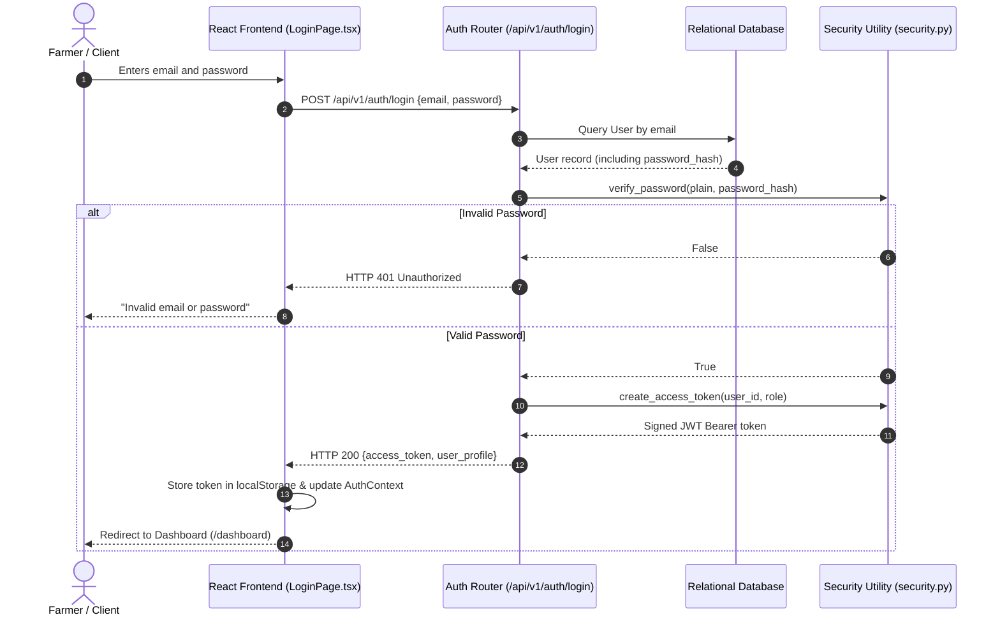
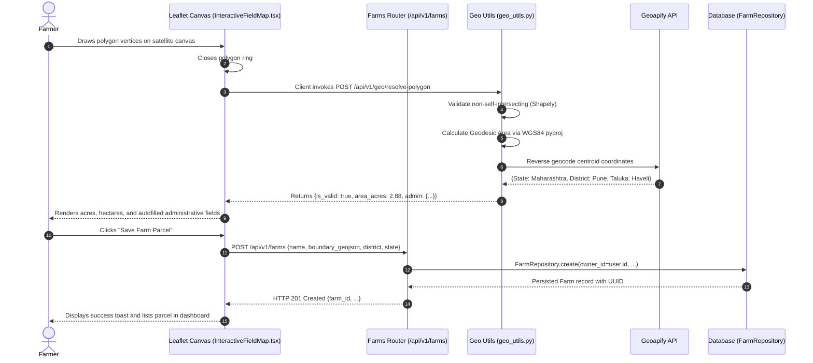
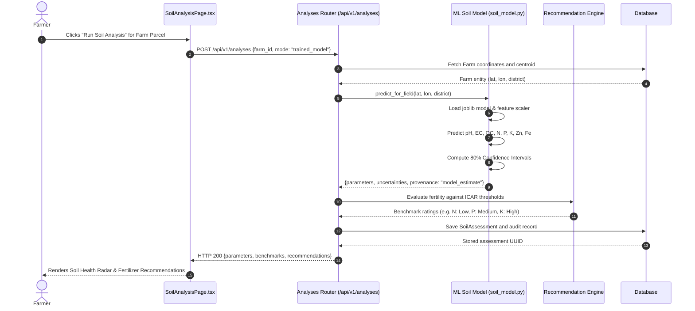
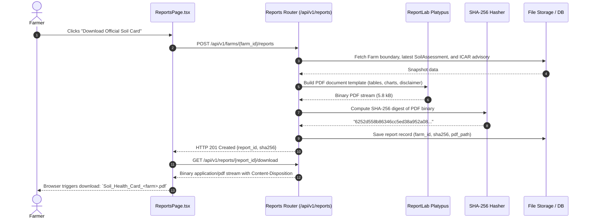

# AI Bhoomi — Codebase Reference & Technical Directory

**Document ID**: ARCH-CODE-002  
**Project**: AI Bhoomi — AI-Powered Sustainable Agriculture Intelligence Platform  
**Version**: 1.0.0  
**Status**: VERIFIED & COMPLETE  
**Audience**: Software Engineers, Technical Leads, Onboarding Developers  

---

## 1. Repository Directory Structure

```
ai-bhoomi/
├── .env.example                      # Production & Development environment template
├── .gitignore                        # Git exclusion rules
├── docker-compose.yml                # Multi-container orchestration (FastAPI + PostGIS + Frontend)
├── package.json                      # Frontend Node.js dependencies & scripts
├── tsconfig.json                     # TypeScript compiler configuration
├── vite.config.ts                    # Vite build configuration, chunking & alias rules
├── index.html                        # Single Page Application entrypoint
│
├── backend/                          # FastAPI Backend Application
│   ├── Dockerfile                    # Container definition for Python 3.14 / FastAPI
│   ├── requirements.txt              # Production Python package manifest
│   └── app/
│       ├── __init__.py
│       ├── main.py                   # Application initialization, middleware, routes
│       ├── config.py                 # Pydantic BaseSettings environment loader
│       ├── db.py                     # SQLAlchemy engine, session maker, base model
│       ├── models.py                 # Core ORM models (Farmer, Field, SoilAssessment, Report)
│       ├── schemas.py                # Pydantic DTOs for request/response serialization
│       ├── security.py               # Password hashing (bcrypt) & JWT token utilities
│       ├── soil_model.py             # In-process ML inference pipeline & regional fallbacks
│       │
│       ├── api/                      # Modular API Sub-routers
│       │   └── v1/
│       │       ├── router.py         # Master API router aggregation (/api/v1)
│       │       ├── auth.py           # Authentication routes (login, register, me)
│       │       ├── farms.py          # Farm parcel management & polygon CRUD
│       │       ├── geo.py            # Geodesic area calculation, search, reverse geocoding
│       │       ├── soil.py           # Soil sample registration & AI estimation
│       │       ├── satellite.py      # Satellite observation ingestion & GEE demo
│       │       ├── recommendations.py# ICAR fertilizer and crop recommendation engine
│       │       ├── reports.py        # ReportLab PDF report generation & binary streaming
│       │       └── ml_ops.py         # Model & dataset registry, metrics, rollback
│       │
│       ├── models/                   # Enhanced ORM Entities
│       │   ├── user.py               # User and Role definitions
│       │   ├── farm.py               # Farm, FarmBoundary, and spatial attributes
│       │   ├── soil.py               # SoilSample and SoilMeasurement entities
│       │   ├── satellite.py          # SatelliteAnalysis and multispectral indices
│       │   └── ml_model.py           # MLModel, MLPrediction, and Report entities
│       │
│       ├── repositories/             # Database Access Layer (Repository Pattern)
│       │   ├── user_repo.py          # User lookups and creation
│       │   ├── farm_repo.py          # Farm CRUD, ownership checks, cascade deletion
│       │   └── soil_repo.py          # Soil measurements query layer
│       │
│       └── services/                 # Domain Services
│           ├── geo_utils.py          # PyProj Geod ellipsoid calculations & Shapely checks
│           ├── geocoding_service.py  # Geoapify forward/reverse geocoding client
│           └── recommendation_engine.py # ICAR agronomic rules calculator
│
├── frontend/                         # React 18 Single Page Application
│   ├── src/
│   │   ├── main.tsx                  # React DOM mount point & router providers
│   │   ├── App.tsx                   # Route definitions & Suspense boundaries
│   │   ├── index.css                 # Global Tailwind directives & theme variables
│   │   │
│   │   ├── components/               # Reusable UI Components
│   │   │   └── InteractiveFieldMap.tsx # Leaflet polygon drawing, vertex markers, area badge
│   │   │
│   │   ├── hooks/                    # Custom React Hooks
│   │   │   └── useAuth.tsx           # Authentication context, login, register, token persistence
│   │   │
│   │   ├── layouts/                  # Page Shells
│   │   │   └── DashboardLayout.tsx   # Top navigation, sidebar, responsive drawer
│   │   │
│   │   ├── pages/                    # Routed Application Views
│   │   │   ├── LandingPage.tsx       # Marketing and public introduction
│   │   │   ├── LoginPage.tsx         # Farmer / Agronomist authentication
│   │   │   ├── RegisterPage.tsx      # New user registration form
│   │   │   ├── DashboardPage.tsx     # Overview of parcels, soil status, quick actions
│   │   │   ├── FarmsPage.tsx         # Parcel list, drawing tool, area calculator
│   │   │   ├── FarmDetailPage.tsx    # Single farm analytics, history, boundaries
│   │   │   ├── SoilAnalysisPage.tsx  # Soil test parameters, radar chart, ML prediction trigger
│   │   │   ├── RecommendationsPage.tsx# ICAR crop & fertilizer stage schedules
│   │   │   ├── ReportsPage.tsx       # PDF report downloads & audit history
│   │   │   ├── SatellitePage.tsx     # NDVI vegetation index inspection (demo mode)
│   │   │   ├── MLOpsPage.tsx         # Model performance metrics, feature weights, registry
│   │   │   └── ProfilePage.tsx       # Farmer preferences, language, settings
│   │   │
│   │   ├── services/                 # HTTP API Client
│   │   │   └── api.ts                # Axios instance with JWT interceptors & endpoint helpers
│   │   │
│   │   └── types/                    # Shared TypeScript Interfaces
│   │       └── index.ts              # DTO definitions (Farm, Soil, Report, User)
│
├── ml/                               # Machine Learning Training & Governance
│   ├── artifacts/
│   │   ├── model_metadata.json       # Versioned metrics, feature importances, R2=0.942
│   │   └── soil_model_pipeline.joblib# Serialized Scikit-Learn regressor pipeline
│   ├── data_validation/
│   │   └── validator.py              # Schema checker for incoming soil CSVs
│   ├── preprocessing/
│   │   └── pipeline.py               # Imputation, regional scaling, outlier clipping
│   └── training/
│       └── train_soil_model.py       # Cross-validation, model training, artifact exporter
│
├── data/                             # Dataset Storage & Schemas
│   ├── maharashtra_soil_part_1.csv   # Regional Vertisol dataset (synthetic demo labeled)
│   ├── maharashtra_soil_part_2.csv
│   ├── maharashtra_soil_part_3.csv
│   ├── maharashtra_soil_part_4.csv
│   └── sample/                       # Verification GeoJSON & CSV samples
│       ├── sample_farm_nashik.geojson
│       ├── sample_farm_pune.geojson
│       └── soil_samples_maharashtra.csv
│
├── docs/                             # Complete Architecture & Handover Package
│   └── ...                           # (Target folder for all master technical documents)
│
└── tests/                            # Automated QA Test Suite
    ├── test_geometry.py              # Geodesic area calculation & polygon rejection tests
    ├── test_soil_model.py            # Model artifact validation, bounds, CI intervals
    └── test_comprehensive_api_e2e.py # 21 End-to-end integration & security test cases
```

---

## 2. Core Workflows & Execution Sequences

### 2.1 User Authentication Flow


### 2.2 Farm Parcel Registration & Geodesic Validation


### 2.3 AI Soil Intelligence Analysis


### 2.4 Auditable PDF Report Generation


---

## 3. Key Source Modules & Class References

### Backend Modules

| File Path | Primary Function / Class | Responsibility |
|:---|:---|:---|
| `app/main.py` | `FastAPI()`, `lifespan()` | Bootstraps server, registers middleware, configures CORS, and aggregates API routers. |
| `app/api/v1/auth.py` | `register()`, `login()`, `me()` | Public account creation and JWT authentication issuing. |
| `app/api/v1/farms.py` | `list_farms()`, `create_farm()`, `delete_farm()` | Farm parcel lifecycle, ownership verification, cascading deletion guards. |
| `app/api/v1/geo.py` | `api_calculate_area()`, `api_resolve_polygon()` | Geodesic area calculations, vertex extractions, and administrative geocoding. |
| `app/services/geo_utils.py` | `_pure_python_polygon_area_sqm()`, `validate_geojson_polygon()` | WGS84 ellipsoidal area formula implementation and Shapely geometry verification. |
| `app/repositories/farm_repo.py` | `FarmRepository` | Async SQLAlchemy queries for farm records, dependent entity checks, and clean cascades. |
| `app/services/recommendation_engine.py` | `calculate_recommendations()` | ICAR Table 4.2 nutrient recommendations and stage-wise split dosage formulas. |
| `app/soil_model.py` | `predict_for_field()`, `is_model_available()` | ML inference execution, feature mapping, and regional Vertisol baseline estimation. |

### Frontend Modules

| File Path | Component / Hook | Responsibility |
|:---|:---|:---|
| `src/App.tsx` | `App()`, React Router | Master routing layout, code-split Suspense wrappers, and navigation hierarchy. |
| `src/components/InteractiveFieldMap.tsx` | `InteractiveFieldMap` | Leaflet map with drawing tools, coordinate vertex labels, and real-time acreage display. |
| `src/hooks/useAuth.tsx` | `AuthProvider`, `useAuth` | Global user state, JWT token storage, login/logout actions, and protected route gating. |
| `src/services/api.ts` | `api` (Axios instance) | Request interceptors for Bearer auth headers and typed endpoint methods. |
| `src/pages/SoilAnalysisPage.tsx` | `SoilAnalysisPage` | Multi-parameter soil test visualization, benchmark classifications, and demo badges. |
| `src/pages/ReportsPage.tsx` | `ReportsPage` | History of generated soil cards, SHA-256 verification badges, and direct PDF downloads. |
