# AI Bhoomi — CI/CD and Release Process

**Document ID**: DEP-CICD-001  
**Project**: AI Bhoomi — AI-Powered Sustainable Agriculture Intelligence Platform  
**Version**: 1.0.0  
**Status**: APPROVED  

---

## 1. CI/CD Pipeline Architecture

```mermaid
graph LR
    Push[Git Push / PR] --> Lint[Static Analysis & Linter]
    Lint --> UnitTests[PyTest Geometry & ML Tests]
    UnitTests --> BuildFE[Vite Production Frontend Build]
    BuildFE --> E2ETests[Comprehensive 21 E2E API Tests]
    E2ETests --> DockerBuild[Docker Image Build & Scan]
    DockerBuild --> DeployStaging[Deploy to Staging Environment]
    DeployStaging --> SmokeTest[Automated Health & Smoke Checks]
    SmokeTest --> Approval[Manual Production Release Gate]
    Approval --> DeployProd[Rolling Production Deployment]
```

---

## 2. Pipeline Stages

### Stage 1: Code Linting & Static Type Checking
- **Frontend**: `npm run lint` / `tsc --noEmit`
- **Backend**: `flake8`, `mypy --ignore-missing-imports`, `black --check`

### Stage 2: Automated Testing Gate
- **Unit Tests**:
  - `python -m pytest tests/test_geometry.py`
  - `python -m pytest tests/test_soil_model.py`
- **Integration Tests**:
  - `python -m pytest tests/test_comprehensive_api_e2e.py`
- **Quality Gate**: 100% pass rate mandatory before any merge to `main`.

### Stage 3: Artifact Generation & Containerization
- Frontend assets compiled via `npm run build` targeting `es2022`.
- Backend Docker container packaged with multi-stage build caching.
- Container vulnerability scanning via Trivy.

### Stage 4: Promotion & Rollback
- Blue-Green or Rolling deployment on production cluster.
- Automated rollback triggered if `/health` returns non-200 for 60 seconds post-deployment.
