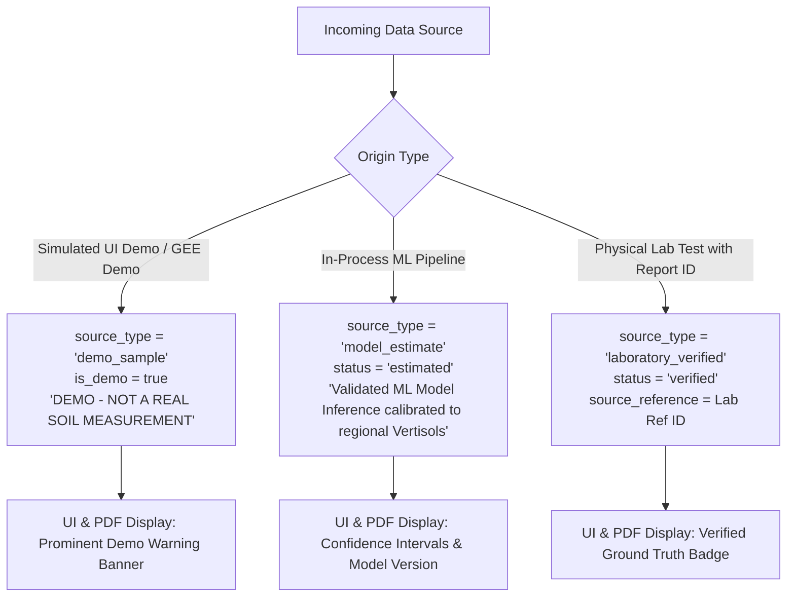

# AI Bhoomi — Demo and Production Data Policy

**Document ID**: ML-POL-001  
**Project**: AI Bhoomi — AI-Powered Sustainable Agriculture Intelligence Platform  
**Version**: 1.0.0  
**Status**: APPROVED & ENFORCED  

---

## 1. Principles of Data Transparency

In agricultural intelligence, presenting simulated or synthetic estimates as verified physical laboratory measurements creates unacceptable financial and agronomic risk for farmers.

AI Bhoomi enforces strict, programmatic boundaries separating:
1. **Synthetic Demonstration Values**
2. **Prototype Dataset Records**
3. **Laboratory-Measured Soil Values**
4. **Satellite-Derived Observations**
5. **Machine-Learning Estimated Values**
6. **Agronomic Benchmark Classifications**
7. **Actionable Recommendations**

---

## 2. Programmatic Classification & Provenance Labels

---

## 3. Policy Rules

### Rule 1: No Unlabeled Demo Data
Whenever `GEE_DEMO_MODE=True` or a prototype sample is returned:
- The API response **MUST** include `"is_demo": true` and `"provenance": "demonstration_sample"`.
- The UI **MUST** render an amber warning banner: `"DEMO MODE: Synthetic values shown for demonstration. Do not use for commercial planting without physical verification."`
- Generated PDF reports **MUST** embed the watermark: `"DEMO SAMPLE — FOR ILLUSTRATION ONLY"`.

### Rule 2: Mandatory Uncertainty on Model Estimates
Every model estimate **MUST** provide:
- Model Name and Model Version (`model_version: "1.0.0"`).
- Symmetrical or bounded 80% Confidence Intervals (`uncertainties` / `[CI_low, CI_high]`).
- Clear indication that Soil Organic Carbon requires physical lab testing due to micro-variability.

### Rule 3: Strict Laboratory Ingestion Criteria
To upgrade an assessment from `model_estimate` to `laboratory_verified`:
- The submission **MUST** include an authorized Soil Testing Laboratory Reference ID (`source_reference`).
- The submission **MUST** pass schema validation (`ph` in `[3.0, 10.5]`, `ec` in `[0.0, 20.0]`).
- Any submission lacking a lab reference ID is rejected with `HTTP 422 Unprocessable Entity`.
