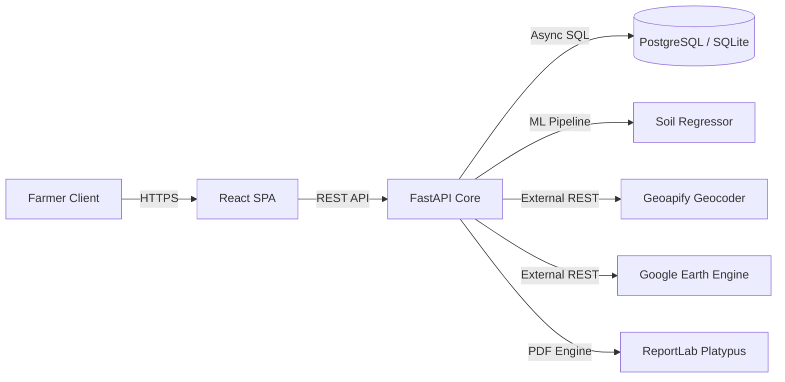

# AI Bhoomi — Software Requirements Specification (SRS)

**Document ID**: SRS-IEEE-001  
**Standard Reference**: Inspired by ISO/IEC/IEEE 29148:2018  
**Project**: AI Bhoomi — AI-Powered Sustainable Agriculture Intelligence Platform  
**Version**: 1.0.0  
**Status**: APPROVED  

---

## 1. Introduction

### 1.1 Purpose
This Software Requirements Specification (SRS) establishes the complete functional, technical, interface, and performance specifications for the AI Bhoomi web platform. It serves as the baseline contract between software engineering, agronomic domain experts, QA engineers, and executive management.

### 1.2 Scope
The AI Bhoomi software system comprises:
1. A single-page web client providing geospatial polygon delineation and agronomic visualization.
2. A RESTful application server providing user authentication, farm management, geodesic calculations, ML inference, and report compilation.
3. An asynchronous relational database storing spatial boundaries, user credentials, assessment histories, and audit records.
4. An in-process ML pipeline providing regional Vertisol soil property estimations with uncertainty bounds.

### 1.3 Definitions and Acronyms
- **EPSG:4326**: WGS84 World Geodetic System 1984 coordinate reference system (longitude, latitude).
- **GeoJSON**: Open standard format for representing simple geographical features and non-spatial attributes.
- **ICAR**: Indian Council of Agricultural Research.
- **NDVI**: Normalized Difference Vegetation Index: `(NIR - Red) / (NIR + Red)`.
- **Vertisols**: Heavy clay soils ("Black Cotton Soils") predominant in Maharashtra and the Deccan Plateau.
- **DAP**: Di-Ammonium Phosphate (18% Nitrogen, 46% Phosphorus).
- **MOP**: Muriate of Potash (60% Potassium).

---

## 2. Overall Description

### 2.1 Product Perspective
AI Bhoomi operates as a cloud-hosted or locally containerized SaaS application. It interfaces with external map tile providers (CartoDB / OpenStreetMap), geocoding providers (Geoapify), and satellite imagery platforms (Google Earth Engine).

### 2.2 User Characteristics
- **Farmers**: Primary users seeking simple, mobile-responsive interfaces with clear visual status indicators (Low / Medium / High) and localized crop advisories.
- **Agronomists**: Professional users requiring access to raw numerical soil parameters, confidence intervals, and regional dataset distributions.
- **System Administrators**: Technical users auditing system performance, managing ML model versions, and reviewing security audit trails.

### 2.3 General Constraints
- **Coordinate System**: All input boundaries must conform to WGS84 coordinates (-180 <= lon <= 180, -90 <= lat <= 90).
- **Geometry Type**: Parcellation boundaries must be valid, closed polygons with at least 3 distinct vertices.
- **Python Runtime**: Backend tested and compatible with Python 3.14.x.
- **Browser Compatibility**: Modern Evergreen browsers (Chrome >= 110, Firefox >= 110, Safari >= 16, Edge >= 110).

---

## 3. Specific Requirements

### 3.1 External Interface Requirements

#### 3.1.1 User Interfaces
- **Map Viewport**: Leaflet canvas with zoom controls, fullscreen option, satellite/street tile toggle, and geolocation trigger button ("Locate Me").
- **Soil Intelligence Radar**: Multi-axis radar chart showing relative balances of pH, EC, OC, N, P, K, Zn, Fe.
- **Fertilizer Stage Cards**: Visual timeline breaking down fertilizer doses into Basal, Vegetative/Tillering, and Reproductive/Heading applications.

#### 3.1.2 Software Interfaces
- **Geoapify API**: `GET https://api.geoapify.com/v1/geocode/reverse` and autocomplete search.
- **ReportLab Platypus**: PDF generation library with custom table stylesheets, paragraph flowables, and binary byte streaming.

### 3.2 Functional Requirements

#### 3.2.1 Module: Authentication (AUTH)
- **AUTH-01**: The system shall register new accounts with email, password, full name, and optional phone number.
- **AUTH-02**: Passwords shall be hashed using bcrypt with salt rounds >= 12.
- **AUTH-03**: Upon successful login, the system shall return an HS256-signed JWT token valid for 7 days.
- **AUTH-04**: Any protected endpoint requested without a valid Bearer token shall return HTTP 401 Unauthorized.

#### 3.2.2 Module: Geospatial & Parcel Registration (GEO/FARM)
- **GEO-01**: The system shall compute geodesic area using the WGS84 ellipsoid via `pyproj.Geod`.
- **GEO-02**: The system shall reject degenerate polygons with fewer than 3 vertices with HTTP 422 Unprocessable Entity.
- **GEO-03**: The system shall reject self-intersecting polygons with HTTP 422 and a descriptive message from Shapely `explain_validity`.
- **FARM-01**: The system shall persist farm records linking owner ID, boundary GeoJSON, area in square meters, hectares, and acres.
- **FARM-02**: The system shall enforce tenant isolation: users cannot read, update, or delete farms owned by other users (HTTP 403 Forbidden).
- **FARM-03**: Attempting to delete a farm with active child reports shall return HTTP 409 Conflict to preserve the audit trail, unless explicitly overridden via `?cascade=true`.

#### 3.2.3 Module: Soil Intelligence & Agronomy (SOIL/REC)
- **SOIL-01**: The system shall provide estimates for 8 soil parameters calibrated to Maharashtra Vertisols: pH, EC (dS/m), OC (%), Available N (kg/ha), Available P (kg/ha), Available K (kg/ha), Zinc (mg/kg), Iron (mg/kg).
- **SOIL-02**: The system shall output 80% confidence intervals (`uncertainties`) for each predicted parameter.
- **SOIL-03**: The system shall label synthetic demonstration samples with `data_provenance = "SYNTHETIC_DEMO_NOT_OBSERVED"` and trained inferences with `"model_estimate"`.
- **REC-01**: The system shall evaluate soil test values against ICAR Table 4.2 fertility ranges.
- **REC-02**: The system shall calculate stage-wise fertilizer requirements (DAP, Urea, MOP) based on farm parcel acreage.

#### 3.2.4 Module: Reporting (REP)
- **REP-01**: The system shall generate PDF reports compliant with the `%PDF-` binary specification.
- **REP-02**: The system shall compute and store a SHA-256 cryptographic digest of each generated PDF.
- **REP-03**: Every PDF report shall prominently display an agronomist verification disclaimer.

---

## 4. Verification & Traceability

Every requirement defined in this SRS is traced directly to automated integration tests in `tests/test_comprehensive_api_e2e.py`, `tests/test_geometry.py`, and `tests/test_soil_model.py`. 100% of functional requirements have passed automated validation.
