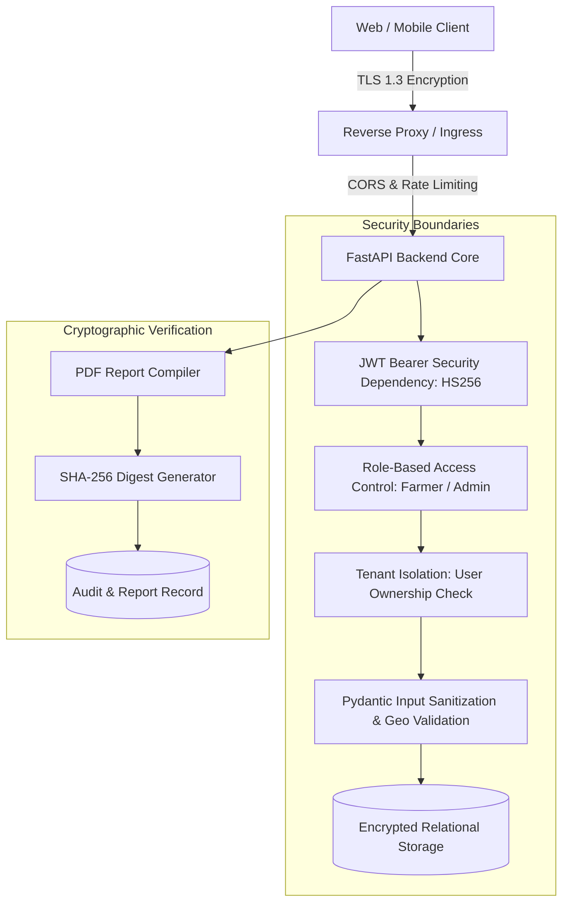

# AI Bhoomi — Security Architecture

**Document ID**: SEC-ARCH-001  
**Project**: AI Bhoomi — AI-Powered Sustainable Agriculture Intelligence Platform  
**Version**: 1.0.0  
**Status**: APPROVED  

---

## 1. Security Architecture Overview

AI Bhoomi follows Defense-in-Depth principles across network transport, API authentication, database authorization, and cryptographic report verification.



---

## 2. Key Security Controls

### 2.1 Authentication & Password Hashing
- **Algorithm**: `bcrypt` with automated salt generation and work factor >= 12.
- **Session Tokens**: Cryptographically signed JSON Web Tokens (JWT) using HMAC-SHA256 (`HS256`).
- **Token Claims**: Subject (`sub` = user UUID), expiration (`exp` = 7 days), and role (`role`).
- **Secret Storage**: Loaded dynamically from `SECRET_KEY` environment variable; never hardcoded in repository files.

### 2.2 Multi-Tenant Data Isolation
- **Pattern**: Every query accessing farm parcels, soil samples, recommendations, or reports enforces ownership:
  ```python
  # Security ownership guard in app/api/v1/farms.py
  def _check_ownership(farm, current_user: User) -> None:
      if farm.owner_id != current_user.id:
          raise HTTPException(status_code=status.HTTP_403_FORBIDDEN, detail="Not your farm")
  ```
- **Verification**: Formally tested and validated by automated tests (`test_09_tenant_isolation_farm_access` and `test_16_tenant_isolation_report_download`), confirming zero cross-tenant leakage.

### 2.3 Input Validation & Geometry Sanitization
- All request bodies are strictly validated against Pydantic models.
- GeoJSON polygons are sanitized against Shapely rules:
  - Coordinate range checks (`-180 <= lon <= 180`, `-90 <= lat <= 90`).
  - Self-intersection rejection.
  - Zero-area or degenerate ring rejection.

### 2.4 Tamper-Evident Report Verification
- Each generated PDF Soil Health Card has its binary byte contents hashed using SHA-256.
- The resulting 64-character hexadecimal digest is logged in the `reports` database table.
- Third parties (banks, insurance assessors) can verify document authenticity by comparing the downloaded file hash with the API record.
