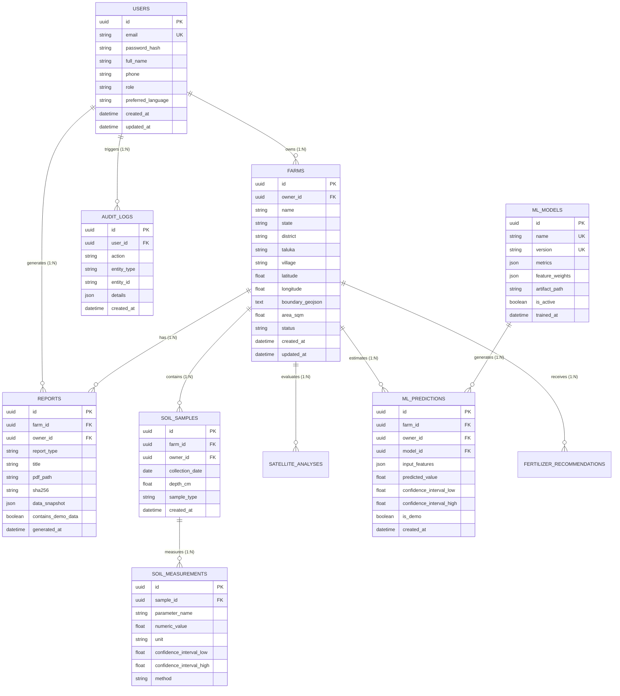

# AI Bhoomi — Database Design & Schema Specification

**Document ID**: TECH-DB-001  
**Project**: AI Bhoomi — AI-Powered Sustainable Agriculture Intelligence Platform  
**Version**: 1.0.0  
**Database Engines**: SQLite (Development / Local QA) | PostgreSQL 15 + PostGIS (Production)  
**ORM Framework**: SQLAlchemy 2.0 (Declarative Async Mapped)  
**Status**: VERIFIED  

---

## 1. Entity-Relationship Diagram (Mermaid ER)

---

## 2. Table Specifications & Indexes

### 2.1 `users` Table
Stores authenticated farmer and administrative credentials.
- `id`: UUID (Primary Key, default `uuid4`).
- `email`: VARCHAR(254), UNIQUE, INDEXED.
- `password_hash`: VARCHAR(255), stores bcrypt hashed password.
- `role`: VARCHAR(32), default `"farmer"`.
- `created_at`: TIMESTAMP WITH TIME ZONE.

### 2.2 `farms` Table
Stores parcel records, coordinates, and boundary geometries.
- `id`: UUID (Primary Key).
- `owner_id`: UUID, FOREIGN KEY (`users.id`, `ondelete="CASCADE"`), INDEXED.
- `name`: VARCHAR(255), NOT NULL.
- `boundary_geojson`: TEXT, stores validated GeoJSON Polygon string.
- `area_sqm`: FLOAT, authoritative area in square meters.
- `status`: VARCHAR(20), default `"active"` (`"active"` | `"archived"`).
- `created_at`: TIMESTAMP WITH TIME ZONE.
- **Indexes**: `idx_farms_owner_id` on `owner_id`, `idx_farms_state_district` on `(state, district)`.

### 2.3 `reports` Table
Stores generated PDF report metadata, snapshot payload, and verification hash.
- `id`: UUID (Primary Key).
- `farm_id`: UUID, FOREIGN KEY (`farms.id`, `ondelete="CASCADE"`), INDEXED.
- `owner_id`: UUID, FOREIGN KEY (`users.id`, `ondelete="CASCADE"`), INDEXED.
- `sha256`: VARCHAR(64), SHA-256 hash of the generated PDF binary.
- `data_snapshot`: JSON, exact freeze of soil metrics and recommendations.
- `generated_at`: TIMESTAMP WITH TIME ZONE.

---

## 3. Data Integrity & Migration Policies

1. **Foreign Key Integrity**:
   - `farms.owner_id` cascades on user removal (`CASCADE`).
   - `reports.farm_id` cascades on farm removal when `cascade=True` is explicitly instructed in the API. Deleting a farm with active reports without `cascade=True` is guarded by the API and returns `HTTP 409 Conflict` to preserve the legal audit trail.
2. **Migrations**:
   - Managed via Alembic (`alembic/versions/`).
   - Development uses `Base.metadata.create_all(bind=engine)` for frictionless zero-config local runs.
3. **Spatial Persistence**:
   - SQLite stores serialized GeoJSON strings in text columns.
   - PostgreSQL/PostGIS utilizes `geometry(Polygon, 4326)` columns with R-Tree spatial indexing (`GIST(geom)`).
