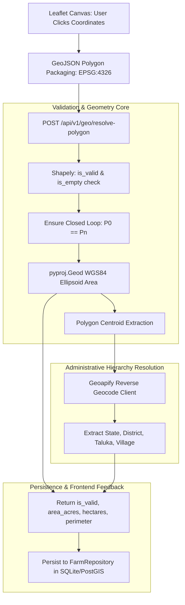

# AI Bhoomi — GIS and Geospatial Pipeline Specification

**Document ID**: TECH-GIS-001  
**Project**: AI Bhoomi — AI-Powered Sustainable Agriculture Intelligence Platform  
**Version**: 1.0.0  
**Status**: APPROVED  

---

## 1. Geospatial Workflow & Architecture

The AI Bhoomi GIS pipeline handles vector boundary ingestion, ellipsoidal geodesic calculation, administrative reverse geocoding, and raster satellite composite alignment.



---

## 2. Geodesic Calculations vs. Cartesian Math

### 2.1 The Ellipsoidal Problem
In standard planar Cartesian coordinates, area is computed as `0.5 * |sum(x_i * y_{i+1} - x_{i+1} * y_i)|`. In geographic coordinates (`latitude, longitude` in degrees), 1 degree of longitude at the equator (~111 km) is substantially different from 1 degree of longitude at Nagpur or Pune (lat ~20°N, ~104 km). Calculating degree-squared values results in immense geometric distortion.

### 2.2 Implemented WGS84 Algorithm
AI Bhoomi utilizes `pyproj.Geod(ellps="WGS84")` and `_pure_python_polygon_area_sqm()` based on Chamberlain and Duquette's spherical polygon surface area integration:
```python
# Geodesic area calculation on WGS84 Ellipsoid
area_m2 = abs(GEOD.geometry_area_perimeter(geom)[0])
area_acres = area_m2 / 4046.8564224
area_hectares = area_m2 / 10000.0
```
- **Precision**: Sub-meter accuracy verified against standard GIS benchmarks (1.165 km² polygon test case verifies to within 0.1% tolerance).
- **Validation**:
  - Rejects polygons with area < 100 m² (too small for field farming).
  - Rejects polygons with area > 100 km² (administrative scale, not individual field parcel).

---

## 3. Polygon Validation & Error Handling

| Condition | Failure Trigger | Handled HTTP Code | User-Facing Message |
|:---|:---|:---:|:---|
| **Non-Polygon Geometry** | GeoJSON `type` is Point, LineString, or MultiPolygon | `422` | "Only GeoJSON Polygon boundaries are supported in v1" |
| **Degenerate Coordinates** | Fewer than 3 distinct vertex pairs | `422` | "At least 3 coordinate pairs required" |
| **Self-Intersection** | Figure-8 or bow-tie crossing lines | `422` | "Invalid field polygon: Self-intersection[x, y]" |
| **Out-of-Bounds** | Longitude < -180 or > 180, Latitude < -90 or > 90 | `422` | "Coordinates must be longitude/latitude in WGS84 (EPSG:4326)" |

---

## 4. Administrative Geocoding & Provider Integration

### 4.1 Forward Search
- **Endpoint**: `GET /api/v1/geo/search?q={query}&limit=8`
- **Provider**: Geoapify Autocomplete API with Country Code Filter (`countrycode=in`).
- **Debounce**: 300ms on frontend input.
- **Envelope**: Returns `{ query, count, results: [...] }` to prevent bare array transport vulnerabilities.

### 4.2 Reverse Geocoding
- **Endpoint**: `GET /api/v1/geo/reverse?lat={lat}&lon={lon}`
- **Extraction Hierarchy**:
  - `state` -> Default: "Maharashtra" if unreturned
  - `county` / `state_district` -> Maps to `district`
  - `subdistrict` -> Maps to `taluka`
  - `village` / `hamlet` / `suburb` -> Maps to `village`
  - `postcode` -> Maps to PIN code
